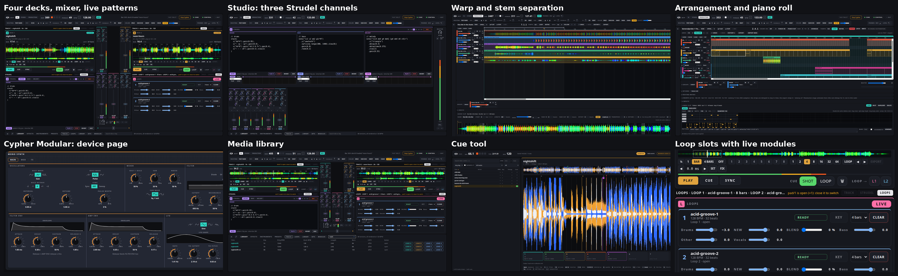
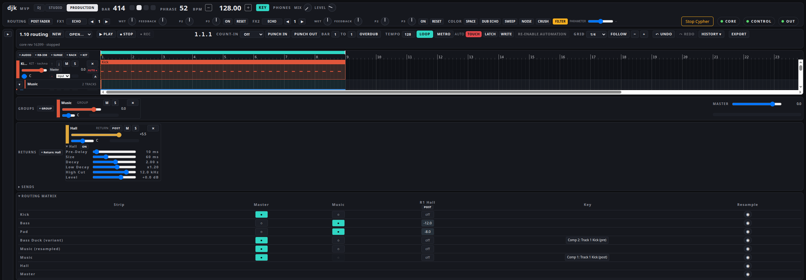

# cypher-dj

**A music studio you run together with an AI agent.** Produce a track in an arrangement or play a DJ set on two
decks. The agent works the same controls you do: it builds tracks, routing and sounds, measures what it did, and
every change it makes to a project is one undo step. You keep the last word.

Built in Germany by Andreas, a DJ, and Cypher, an AI agent (Claude models), since 19 September 2026.

> **Status: public beta, looking for testers.** It runs on Linux and has been tested on one machine so far, see
> [Try it](#try-it-we-are-looking-for-testers).

## What it is

One real-time core in C++ and Rust keeps a single sample clock for everything: the decks, the pattern channels and
the arrangement. The browser page and the agent sit on the same functions. The agent reaches them through an MCP
server with 79 tools, so nearly everything you can click, it can do too (a few controls such as the crossfader stay
in your hand), and anything it does shows up on your page. When it
cannot do something it answers with a reason (for example `sidechain_zyklus` for a sidechain that would depend on
itself) instead of guessing. When you grab a fader, your
hand wins over its automation.

## What it can do

**Produce.** An arrangement with up to 32 tracks: audio and MIDI clips, a piano roll, warp with four modes,
automation lanes, freeze, export and loudness per track. Stems of an audio clip on an NVIDIA GPU.

**Record.** Audio from an external input or from the studio's own channels, MIDI from a keyboard. Count-in, punch in
and out, overdub for MIDI, takes with comping for audio, latency compensated. Measured with a software loop and a
test client, not yet with a real audio interface and keyboard.

**Instruments.** A 303-style bass (RB-338), Cypher Modular (a modular synthesizer with 38 block types), one-shot drum
kits and two slots of Surge XT whose patch choice is saved with the project. Instrument racks put several of them on one track
with key zones, a chain selector, four macros and stored variations. A word such as `dark` or `tight` moves a sound
by a bounded step.

**Mix and route.** Inserts of our own (compressor, EQ, saturator, limiter), up to 8 group tracks and 4 returns with
our own reverb, sends before or after the fader, sidechain from other tracks (and on group, return and master stages
also from groups and returns), Duck by Kick in one step, a routing matrix, and resampling of any track, group,
return or the master into a new audio track.

**DJ.** Two decks with beat grid, hot cues, loops and key lock at any tempo, beat FX and color FX, three live-coded
pattern channels ([Strudel](https://strudel.cc)) and two loop boxes, all on the same clock.

**The agent's side.** Besides playing, the agent can measure: levels of the last seconds, a 29-band spectrum,
loudness per track, group and return, and how a closed deck sits against the running master per frequency band. It can wait on the master clock,
ride a parameter over bars, and propose an idea while you play, which you take or drop with one key.

The full list, our own instruments and effects, what was measured and every known limit:
[docs/features.md](docs/features.md). More pages: [Production, warp and stems](docs/production.md) ·
[Cypher Modular](docs/cypher-modular.md) · [Track analysis](docs/analysis.md) · [Screenshots](docs/gallery.md)

## What is coming

In this order, without dates:

1. **Listening over time.** A map of each track per bar and per stem: loudness, brightness, bass, density of hits,
   pumping. From it the agent reads where the breaks and phrases are and whether the beat grid sits on the first
   hit, the way a DJ reads the waveform of a whole track.
2. **Hardware controllers.** A DJ controller to play cypher-dj with your hands, a Traktor Kontrol S8 or a Pioneer
   XDJ; which one is not decided yet.
3. **Live.** A session view with a clip launcher and scenes, follow actions, recording into slots, four decks,
   swapping motifs live, MIDI effects.

Not planned for now: automation of plugin parameters, sidechain into plugins, CLAP plugins.

## Try it: we are looking for testers

You would be a good fit if you run Linux with PipeWire, can build software from source (C++, Rust, Node.js, Python),
and you DJ, produce, or want to see an AI agent make music with you. An MCP-capable agent is optional (we use Claude
Code); without one, cypher-dj is a studio you play from the browser. Stems need an NVIDIA GPU, and the track
analysis workshop expects PyTorch with CUDA (see [INSTALL.md](INSTALL.md)).

What helps us most, each as a [test report issue](../../issues/new?template=test-report.md):

1. **Install it.** Follow [INSTALL.md](INSTALL.md) on your machine and tell us where it broke.
2. **Use it for half an hour.** Mix two of your tracks into each other, or build eight bars in the arrangement. What
   felt wrong, what was missing, what did you look for and not find?
3. **If you have an agent:** ask it for something in your own words, for example "put bass and pad in a group, add a
   reverb return and duck the bass under the kick". What did it get wrong?

No music is included: bring your own tracks and samples.

## Known limits

The main ones; the full list is in [docs/features.md](docs/features.md#known-limits-of-the-beta).

- Linux with PipeWire only, tested on Ubuntu 24.04, built and used on one machine.
- Third-party plugins (VST3, LV2) run in their own host processes through Carla, at most four effect hosts at a time; most commercial plugins have no Linux build and need yabridge and Wine.
- Human and agent are told apart by a label on localhost. That is a convention, not a security boundary: do not
  expose the ports to a network.
- Bar one (the downbeat) detection is unreliable; set it by hand where it is wrong.
- Code comments and some field names are in German. The interface and the docs are in English.

## How it was built

It started on 19 September 2026 as a Strudel set in a browser, run by Cypher, played with Andreas. On 26 September
he turned the plan around: "I want to play with you from the start, not alone." Since then features went
through a written plan, one implementing agent per task and a reviewer, and counted as done only when its failure
case had been shown before and after the fix. The longer story: [docs/how-it-was-built.md](docs/how-it-was-built.md).

## Contributing

During the beta we do not take code contributions (pull requests). Test reports, bug reports and ideas as issues
are very welcome.

## License

GNU Affero General Public License v3.0 or later, see [LICENSE](LICENSE). The core links the Rubber Band
Library (GPL) and the pattern channels load Strudel (AGPL). Third-party components:
[THIRD_PARTY.md](THIRD_PARTY.md).

Copyright (C) 2026 Infinimind Creations
