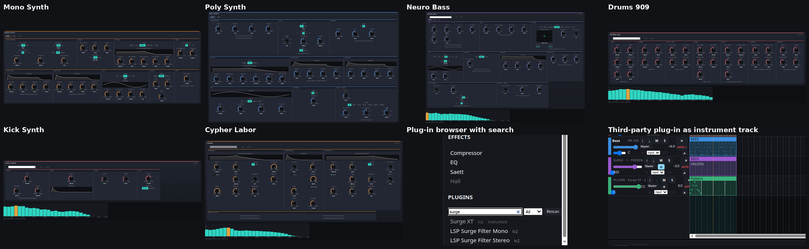
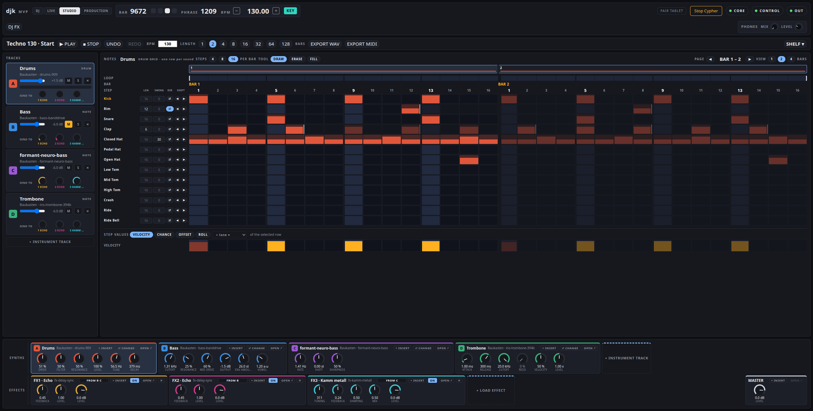
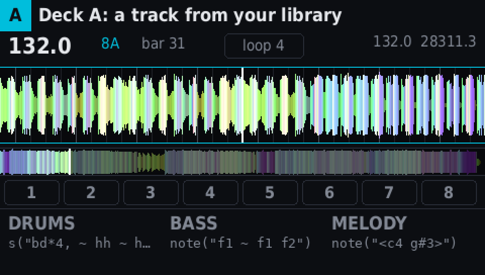
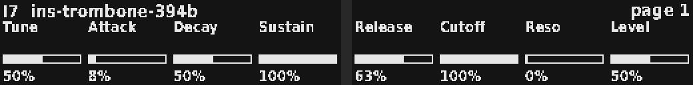
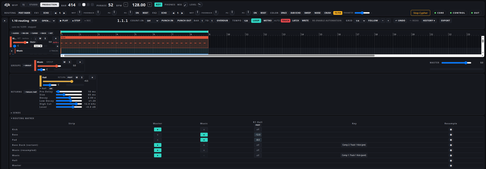

# cypher-dj

**A music studio you run together with an AI agent.** Produce a track in an arrangement or play a DJ set on up
to four decks. The agent works the same controls you do: it builds tracks, routing and sounds, measures what it did, and
every change it makes to a project is one undo step. You keep the last word.

Built in Germany by Andreas, a DJ, and Cypher, an AI agent (Claude models), since 19 September 2026. See
[Who builds it](#who-builds-it).

> **Status: public beta, looking for testers.** It runs on Linux; it is used on one machine and was installed and started from scratch on a fresh Ubuntu 24.04, see
> [Try it](#try-it-we-are-looking-for-testers).

## What it is

One real-time core in C++ and Rust keeps a single sample clock for everything: the decks, the pattern channels and
the arrangement. The browser page and the agent sit on the same functions. The agent reaches them through an MCP
server with 99 tools, so nearly everything you can click, it can do too (a few controls such as the crossfader stay
in your hand), and anything it does shows up on your page. When it
cannot do something it answers with a reason (for example `sidechain_zyklus` for a sidechain that would depend on
itself) instead of guessing. When you grab a fader, your
hand wins over its automation.

## At a glance

**Five views on one clock**

| View | What you do there |
|---|---|
| DJ | Four places, each a track deck, the Strudel pattern channels, a loop deck or a SEQ pattern deck; mixer, beat FX, color FX and the Cypher Remix station |
| LIVE | The three live-coded pattern channels side by side, each with automation lanes for fader, filter and cutoff |
| STUDIO | A loop workbench: up to eight instrument tracks, a step sequencer with a length, swing and direction per row, and a dock of device cards |
| PRODUCTION | An arrangement with up to 32 tracks: audio and MIDI clips, piano roll, warp, automation, groups, returns, inserts, export and loudness per track |
| TRACKER | The same production project as tracker rows: linked patterns, classic effect commands (arpeggio, slides, vibrato, retrigger and more), 8-bit devices, import of ProTracker modules |

**Instruments, effects and hardware** (our own devices built as [Cypher Modular](docs/cypher-modular.md) graphs unless noted; 213
factory presets)

| Kind | Devices |
|---|---|
| Synthesizers | Mono Synth, Poly Synth, Neuro Bass, Kraken (semi-modular, with a 16 by 16 patch field), Greif (hybrid wavetable), Band Drive Bass, three wavetable synths (reese, supersaw, choir), Cypher Labor |
| Drums | Drums 909, Drums 808, Drum Synth (eight synthesised pads), Kick Synth, one-shot drum kits |
| 8-bit | an Amiga-style sample voice, chip pulse, triangle and noise |
| More sources | RB-338 (a 303-style bass, its own engine), a sampler and multisample instrument, two slots of Surge XT, third-party VST3 and LV2 instruments |
| Effects | Cypher EQ, Cypher Hall, Cypher Komp, Cypher Saett (Rust, also as VST3), a limiter and utility stage, Filterbox, a tempo-synced delay, Cypher Remix, and more effect graphs |
| Hardware | Traktor Kontrol S8 (both screens drawn by cypher-dj), Maschine MK2 (displays show the knobs), Akai APC20, Novation Launch Control 3, Akai LPD8, any class-compliant MIDI controller |

Every device has a front panel with real units and MIDI learn, a device window for a second monitor, and controls
that are not heard with the current settings are greyed.

## What it can do

**Produce.** An arrangement with up to 32 tracks: audio and MIDI clips, a piano roll, warp with four modes,
automation lanes, freeze, export and loudness per track. Stems of an audio clip on an NVIDIA GPU.

**Record.** Audio from an external input or from the studio's own channels, MIDI from a keyboard. Count-in, punch in
and out, overdub for MIDI, takes with comping for audio, latency compensated. Measured with a software loop and a
test client, not yet with a real audio interface and keyboard.

**Instruments.** A 303-style bass (RB-338), Cypher Modular (a modular synthesizer with 61 block types, with a mono
synth, a poly synth, a neuro bass, two drum machines and a filter effect built from it), one-shot drum
kits and two slots of Surge XT whose patch choice is saved with the project. Every instrument has a front panel with
real units and MIDI learn (Cypher Modular plates also pick and save presets), which opens enlarged on a device page; a tablet in your home network can show it as a
touch view. Instrument racks put several of them on one track
with key zones, a chain selector, four macros and stored variations. A word such as `dark` or `tight` moves a sound
by a bounded step.

**Build loops.** The STUDIO view is a loop workbench: up to eight instrument tracks over 1 to 128 bars, a dock of
device cards with the effects you load and a send knob per track, and a step sequencer in which every drum row has
its own length, swing and direction, with velocity, chance, offset and roll per step. Loops are cut into slices that
play as an instrument, and your own samples become instruments too: one file across the keys, or a folder of note
samples as a multisample instrument with velocity layers, round robin, sustain loops and release samples.
The shelf searches the whole sample catalog by text and instrument class, keeps favourites and recently used samples
first, and a sample can be dragged onto the track list or onto a row of a drum kit.

**Mix and route.** Inserts of our own (compressor, EQ, saturator, limiter), up to 16 group tracks and 4 returns with
our own reverb, sends before or after the fader, sidechain from other tracks (and on group, return and master stages
also from groups and returns), Duck by Kick in one step, a routing matrix, and resampling of any track, group,
return or the master into a new audio track.

**DJ.** Up to four decks with beat grid, hot cues, loops and key lock at any tempo, beat FX and color FX, three live-coded
pattern channels ([Strudel](https://strudel.cc)) and two loop decks, all on the same clock. The DJ view has four
places, each showing a track deck, the Strudel channels, a loop deck or a SEQ deck; the main mixer has four
channels and each fader belongs to its place (1 is A, 2 is B, 3 is L1, 4 is L2), whatever the place shows. A loop deck has
four tracks of eight cells that launch on a grid, scenes, slices and a channel strip per track (EQ, HALL and DELAY sends, an
effect); the Strudel sum can be recorded into a loop track as a cell. The SEQ deck is a pattern sequencer:
a pattern plays one instrument, you add lanes of notes, of values per step or of drawn curves on any knob of that
instrument, in 1/4 to 1/32 per lane. Cypher Remix, a beat-synchronous remix station (build-up and break-down effects,
a three-band isolator, a pad with roll and drum voices, a release lever), is the third FX unit: every channel strip
has a key 3 that sends it through the Remix.

**Hardware controllers.** An Akai APC20 is the DJ console, and while the PRODUCTION view is shown it is the project mixer
(faders, master, mute, solo, arm, transport, banks of eight tracks). The displays of two devices show cypher-dj
itself: the two screens of a Traktor Kontrol S8 draw our own pages (a scrolling waveform with hot cue marks, a
whole-track overview, and the Strudel, loop deck and SEQ deck views), and its touch strips and hot cue pads work the
DJ view; on a Maschine MK2 the two displays show the names and values of the Cypher Modular knobs its encoders turn,
page by page. Any class-compliant MIDI controller can be learned, up to eight at once. A Novation Launch Control 3 or an Akai LPD8 follows the synth in front
(the Launch Control 3 with factory programs for every instrument panel), and the keys of a MIDI keyboard play the instrument in front. What is confirmed on
the devices and what is not is listed in [docs/features.md](docs/features.md#hardware-controllers).

 

**The agent's side.** Besides playing, the agent can measure: levels of the last seconds, a 29-band spectrum,
loudness per track, group and return, and how a closed deck sits against the running master per frequency band. It can wait on the master clock,
ride a parameter over bars, and propose an idea while you play, which you take or drop with one key.

The full list, our own instruments and effects, what was measured and every known limit:
[docs/features.md](docs/features.md). More pages: [Production, warp and stems](docs/production.md) ·
[Cypher Modular](docs/cypher-modular.md) · [Track analysis](docs/analysis.md) · [Screenshots](docs/gallery.md)

## What is coming

In this order, without dates:

1. **Listening over time.** A map of each track per bar and per stem: loudness, brightness, bass, density of hits,
   pumping. From it the agent reads where the breaks and phrases are and whether the beat grid sits on the first
   hit, the way a DJ reads the waveform of a whole track.
2. **Hardware controllers, further.** More devices (a Maschine Jam and a Pioneer XDJ-XZ are known but not bound), the
   S8 button lights beyond PLAY and LOOP, finer touch strip feel, and a check by hand of what so far was only tested
   by injecting MIDI (see [Hardware controllers](docs/features.md#hardware-controllers)).
3. **Live.** A session view with a clip launcher and scenes, follow actions, recording into slots,
   swapping motifs live, MIDI effects.

Not planned for now: automation of plugin parameters, sidechain into plugins, CLAP plugins.

## Try it: we are looking for testers

You would be a good fit if you run Linux with PipeWire, can build software from source (C++, Rust, Node.js, Python),
and you DJ, produce, or want to see an AI agent make music with you. An MCP-capable agent is optional (we use Claude
Code); without one, cypher-dj is a studio you play from the browser. Stems need an NVIDIA GPU, and the track
analysis workshop expects PyTorch with CUDA (see [INSTALL.md](INSTALL.md)).

What helps us most, each as a [test report issue](../../issues/new?template=test-report.md):

1. **Install it.** Follow [INSTALL.md](INSTALL.md) on your machine and tell us where it broke.
2. **Use it for half an hour.** Mix two of your tracks into each other, or build eight bars in the arrangement. What
   felt wrong, what was missing, what did you look for and not find?
3. **If you have an agent:** ask it for something in your own words, for example "put bass and pad in a group, add a
   reverb return and duck the bass under the kick". What did it get wrong?

No music is included. djk-starter generates kits, loops and a demo on your machine; djk-bibliothek reads your own folders.

## Known limits

The main ones; the full list is in [docs/features.md](docs/features.md#known-limits-of-the-beta).

- Linux with PipeWire only, tested on Ubuntu 24.04: used on one machine, and installed from scratch on a fresh Ubuntu 24.04.5 (2026-11-22) up to the demo playing, without a real audio device.
- Third-party plugins (VST3, LV2) run in their own host processes through Carla, at most four effect hosts at a time; most commercial plugins have no Linux build and need yabridge and Wine.
- Human and agent are told apart by a label on localhost. That is a convention, not a security boundary: do not
  expose the ports to a network.
- Bar one (the downbeat) detection is unreliable; set it by hand where it is wrong.
- Code comments and some field names are in German. The interface and the docs are in English.

## How it was built

It started on 19 September 2026 as a Strudel set in a browser, run by Cypher, played with Andreas. On 26 September
he turned the plan around: "I want to play with you from the start, not alone." Since then features went
through a written plan, one implementing agent per task and a reviewer, and counted as done only when its failure
case had been shown before and after the fix. The longer story: [docs/how-it-was-built.md](docs/how-it-was-built.md).

## Who builds it

- **Andreas**, a DJ from Germany: the direction, the ear, and every decision about how it should sound and feel.
- **Cypher**, an AI agent on Anthropic's Claude models: writes the code, the tests and this documentation, measures
  sounds and mixes, and plays and produces in the studio through the same tools it built. In November 2026 it
  produced a five-minute techno track entirely inside cypher-dj (tracker, Kraken, Drum Synth, a tuned kick), which
  Andreas then judged by ear.

From 20 November 2026 on, the public commits carry both names.

## Contributing

During the beta we do not take code contributions (pull requests). Test reports, bug reports and ideas as issues
are very welcome.

## License

GNU Affero General Public License v3.0 or later, see [LICENSE](LICENSE). The core links the Rubber Band
Library (GPL) and the pattern channels load Strudel (AGPL). Third-party components:
[THIRD_PARTY.md](THIRD_PARTY.md).

Copyright (C) 2026 Infinimind Creations
