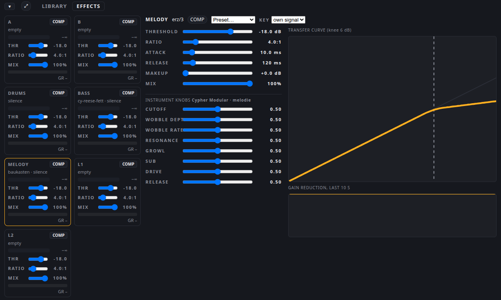
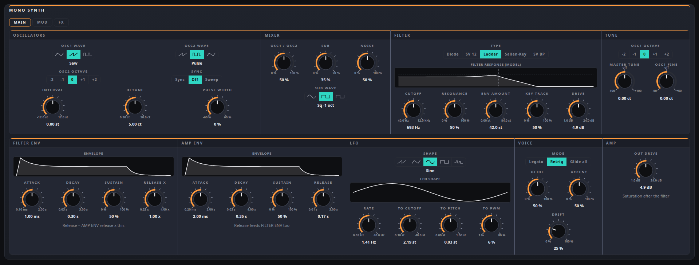

# Cypher Modular

A modular synthesizer, written in Rust (`djk/instruments/modular_dsp`) and built as a VST3 plugin with nih-plug
(`djk/instruments/modular`). It plays on the melody channel, and the core can also load a graph itself, so it sits in
other places too: on the bass channel, on five extra pattern streams, on production instrument tracks and as an effect
on DJ channels and send returns (see "Where a graph can sit"). Its patch is not a preset file of knob positions but a graph: building blocks and
the wires between them, in JSON.



## Install and run

```sh
djk/instruments/install.sh baukasten
djk/start/djk-instrumente --melodie baukasten
```

The host reads the patch from `~/.config/cypherdj/baukasten-melodie.json` each time it starts. Without that file it
plays the built-in `saege-ladder` patch; a broken file also falls back to it and logs `graph rejected, playing built-in`.

## A patch

The smallest example, `demos/saege-ladder.json`: a sawtooth through a ladder filter, shaped by an envelope.

```json
{
  "format": "baukasten/1",
  "name": "saege-ladder",
  "stimmen": 8,
  "knoten": [
    {"id": "note", "art": "note"},
    {"id": "osz", "art": "saege"},
    {"id": "filter", "art": "ladder"},
    {"id": "env", "art": "adsr", "a": 0.005, "d": 0.4, "s": 0.6, "r": 0.3},
    {"id": "vca", "art": "mul"},
    {"id": "aus", "art": "ausgang"}
  ],
  "kanten": [
    {"von": "note.hz", "nach": "osz.hz"},
    {"von": "osz.aus", "nach": "filter.x"},
    {"von": "note.gate", "nach": "env.gate"},
    {"von": "filter.aus", "nach": "vca.a"},
    {"von": "env.aus", "nach": "vca.b"},
    {"von": "vca.aus", "nach": "aus.x"}
  ]
}
```

(Shortened; the file in the repository also sets cutoff, resonance and levels.) The field names are German, like the
code: `knoten` are nodes, `kanten` are wires, `art` is the block type, `stimmen` the number of voices, `von` and
`nach` are from and to.

## The blocks

| Group | Blocks (`art`) |
|---|---|
| Notes and control | `note` (hz, gate, velocity, trigger), `konst`, `regler` (one of the knobs, mapped to a range, with an optional start value `vorgabe` and centre value `mitte`), `transponiere`, `glatt` (smoothing) |
| Oscillators and noise | `saege`, `puls`, `dreieck`, `sinus`, `rauschen`; the saw, pulse and triangle also take a band-limited hard sync input and output (`hart`) |
| Sound sources | `trommeln` (a drum kit in one block: the note picks the drum), `wavetable` (band-limited tables with up to seven detuned copies in one voice), `fm` (six operators, sixteen algorithms), `granular` (grains of a generated source), `resonator` (a modal bank of up to 32 modes per voice), `saite` (a digital waveguide string), `metall` (metallic oscillator bank for hi-hats and cymbals), `sampler` (plays a sample file) |
| Filters and shaping | `ladder`, `svf`, `saett` (saturation), `roehre` (one triode stage), `krume` (bit and sample rate reduction), `ms20` (low-pass and high-pass with saturating feedback), `sem` (12 dB state-variable filter that morphs from low-pass through notch to high-pass, plus a band-pass output), `diode` (diode-ladder low-pass), `kamm` (tuned feedback comb filter), `formant` (vowel filter of five parallel band-passes), `falter` (wavefolder with antialiasing and 2x oversampling), `labor` (Cypher Labor, see below) |
| Modulation | `adsr`, `lfo`, `mseg` (multi-stage envelope, up to eight stages with curves, a sustain stage and a loop), `sh` (sample and hold, clocked by a trigger, in beats or in Hz), `folger` (envelope follower), `drift` (per-voice analog drift) |
| Arithmetic | `mul`, `add` |
| Effects | `chorus`, `phaser`, `hall` (reverb), `delay`, `faltung` (convolution with an impulse response file, no added latency), `vocoder` (11-band channel vocoder) |
| Dynamics | `limiter`, `gate`, `komp` |
| Wiring | `ausgang` (output), `eingang` (input, for effect graphs), `leitung` (a feedback path that can be wired freely), `wahl` (a selector over up to eight inputs, with a crossfade) |

That makes 51 block types. The graph is checked when it loads and runs in a fixed order. Feedback is only allowed through
a wire marked `"verzoegerung": 1` or through `leitung`. Up to 16 voices run side by side; the audio callback does not
allocate.

## Knobs

Each patch can use up to 64 knobs (`Knob 1` to `Knob 64`, values 0 to 1) and name them in `regler_namen`
(format `baukasten/2`). A `regler` node reads one of them and maps it
to a range, linear or logarithmic. On the page they appear in the expanded EFFECTS view of the channel (screenshot
above); the agent turns them through the same route (`/klang`). A `regler` node can carry a start value `vorgabe`
(the knob position a graph starts at, 0 to 1, default 0.5) and a centre value `mitte` (the value at knob position 0.5),
so a new knob can begin at "off" while older projects and presets keep their sound. The VST3 plug-in exposes 32 knob
parameters.

## Front panels

Each graph can ship a front panel (a plate) next to it: a JSON file that binds controls to knobs with real units,
selectors with waveform symbols, and envelope, LFO shape and filter curve displays. A graph without one gets an
automatic panel. The plate opens enlarged on a device page, with a live spectrum of the channel, and a preset picker
and a save button sit in its header.



## Instruments built from the blocks

- **Mono Synth** (`synth-mono`): two oscillators with hard sync, a sub, noise, five switchable filters, filter and
  amplifier envelopes, a modulation envelope, two LFOs (the second with tempo sync and a choice of target), glide,
  velocity depth, tuning, drift, and chorus, delay and reverb.
- **Poly Synth** (`synth-poly`): eight voices, a unison stack of up to seven saws, a second oscillator, three filters,
  a modulation envelope, two LFOs, glide, velocity depth, tuning, drift and a chorus.
- **Neuro Bass** (`synth-neuro`): three detuned copies bent by FM, ring modulation and a wavefolder, seven switchable
  filters, a tempo-synced second LFO, sample and hold, a second oscillator, key follow, delay and reverb.
- **Drums 909 and Drums 808** (`drums-909`, `drums-808`): two drum machines built on the `trommeln` block.
- **Filterbox** (`fx-filterbox`): an effect with six filter models and three modulation sources.
- **Cypher Labor** (`labor`, `fx-labor`): a two-channel feedback processor in one block: a model of a one-bit
  delay chip, a resonant filter whose resonance depends on the level, clipping, channel and cross feedback and one
  modulator, run sample by sample at twice the base rate. As an instrument a note pings both filters (key tracking,
  note gate, width); as an effect the left side runs through channel 1 and the right through channel 2. It is new and
  experimental: one listening session so far, no presets yet.

The new controls of the three synthesizers were added without changing any old sound: with every new knob at its start
value, the graphs render byte for byte as before. Their numbers were measured on synthetic signals; the new controls have not
been judged by a listener yet.

## Where a graph can sit

- the melody channel, as before, and the bass channel (the graph replaces that channel's sound, the pattern keeps
  playing through it);
- erz/5 to erz/7 and the two loop box pads, each as an instrument on its own pattern stream (start the studio with
  `djk/start/djk-start --strudel --bk-stroeme`); these streams can be recorded onto production tracks;
- a production instrument track (the device is the graph and its eight knob values; up to 8 such tracks), played from the
  project's notes live and in the offline render;
- an effect graph on a deck channel or on one of two send returns (the examples `fx-*`: echo, spring reverb, filter ride,
  phaser, flanger, tube, vocoder and others).

The knobs of a graph on a channel can be learned onto a MIDI controller, and a project remembers which graph sits
on which channel with its knob values.

## Example patches

In `djk/instruments/modular_dsp/demos/`: `juno-pad` (eight voices, chorus; with reverb, echo or dynamics in the
`-hall`, `-echo` and `-dyn` variants), `lead` (sync lead), `bassmusik` (wobble bass with growl), `saite` (a plucked
string), `rueckkopplung` (a feedback patch), `saege-ladder`, and since then `fm-*` (bass, electric piano, bell, lead),
`wavetable-*` (supersaw, reese, choir), `granular-*`, `resonator-*`, `metall-*` (hi-hat, ride, crash), `saite-*`
(guitar, harp, piano, Karplus-Strong), `hartsync-*`, `sampler-fairlight`, `synth-mono`, `synth-poly`, `synth-neuro`, `drums-909`, `drums-808` and the `fx-*` effect graphs (among them `fx-filterbox`). 103 factory presets of our own devices ship with the preset browser, 55 of them for Cypher Modular graphs. The folder
`rezepte/` holds 46 more, one per sub-type of the instrument vocabulary (bass 8, drums 5, fx 5, keys 6, lead 7, pad 6,
percussion 5, pluck 4), each built from a written recipe card.
