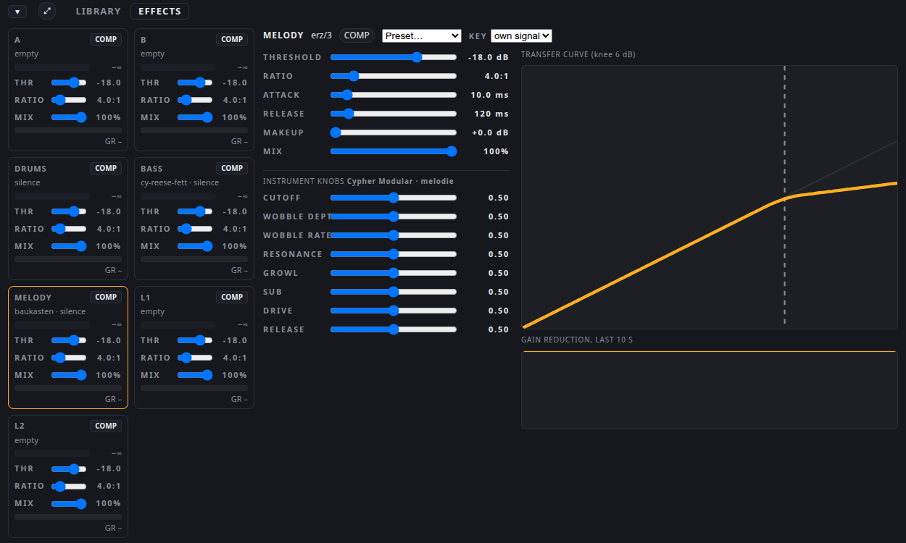

# Cypher Modular

A modular synthesizer, written in Rust (`djk/instrumente/baukasten_dsp`) and built as a VST3 plugin with nih-plug
(`djk/instrumente/baukasten`). It plays on the melody channel. Its patch is not a preset file of knob positions but a
graph: building blocks and the wires between them, in JSON.



## Install and run

```sh
djk/instrumente/installiere.sh baukasten
djk/start/djk-instrumente --melodie baukasten
```

The host reads the patch from `~/.config/cypherdj/baukasten-melodie.json` each time it starts. Without that file it
plays the built-in `saege-ladder` patch; a broken file also falls back to it and logs `graph rejected, playing built-in`.

## A patch

The smallest example, `beispiele/saege-ladder.json`: a sawtooth through a ladder filter, shaped by an envelope.

```json
{
  "format": "baukasten/1",
  "name": "saege-ladder",
  "stimmen": 8,
  "knoten": [
    {"id": "note", "art": "note"},
    {"id": "osz", "art": "saege"},
    {"id": "filter", "art": "ladder"},
    {"id": "env", "art": "adsr", "a": 0.005, "d": 0.4, "s": 0.6, "r": 0.3},
    {"id": "vca", "art": "mul"},
    {"id": "aus", "art": "ausgang"}
  ],
  "kanten": [
    {"von": "note.hz", "nach": "osz.hz"},
    {"von": "osz.aus", "nach": "filter.x"},
    {"von": "note.gate", "nach": "env.gate"},
    {"von": "filter.aus", "nach": "vca.a"},
    {"von": "env.aus", "nach": "vca.b"},
    {"von": "vca.aus", "nach": "aus.x"}
  ]
}
```

(Shortened; the file in the repository also sets cutoff, resonance and levels.) The field names are German, like the
code: `knoten` are nodes, `kanten` are wires, `art` is the block type, `stimmen` the number of voices, `von` and
`nach` are from and to.

## The blocks

| Group | Blocks (`art`) |
|---|---|
| Notes and control | `note` (hz, gate, velocity, trigger), `konst`, `regler` (one of the eight knobs, mapped to a range), `transponiere`, `glatt` (smoothing) |
| Oscillators and noise | `saege`, `puls`, `dreieck`, `sinus`, `rauschen` |
| Filters and shaping | `ladder`, `svf`, `saett` (saturation) |
| Modulation | `adsr`, `lfo` |
| Arithmetic | `mul`, `add` |
| Effects | `chorus`, `hall` (reverb), `delay` |
| Dynamics | `limiter`, `gate`, `komp` |
| Wiring | `ausgang` (output), `eingang` (input, for effect graphs), `leitung` (a feedback path that can be wired freely) |

The graph is checked when it loads and runs in a fixed order. Feedback is only allowed through a wire marked
`"verzoegerung": 1` or through `leitung`. Up to eight voices run side by side; the audio callback does not allocate.

## Knobs

Each patch can use up to eight knobs (`Knob 1` to `Knob 8`, values 0 to 1) and name them in `regler_namen`
(format `baukasten/2`). A `regler` node reads one of them and maps it
to a range, linear or logarithmic. On the page they appear in the expanded EFFECTS view of the channel (screenshot
above); the agent turns them through the same route (`/klang`).

## Example patches

In `djk/instrumente/baukasten_dsp/beispiele/`: `juno-pad` (eight voices, chorus; with reverb, echo or dynamics in the
`-hall`, `-echo` and `-dyn` variants), `lead` (sync lead), `bassmusik` (wobble bass with growl), `saite` (a plucked
string), `rueckkopplung` (a feedback patch), `saege-ladder`.
