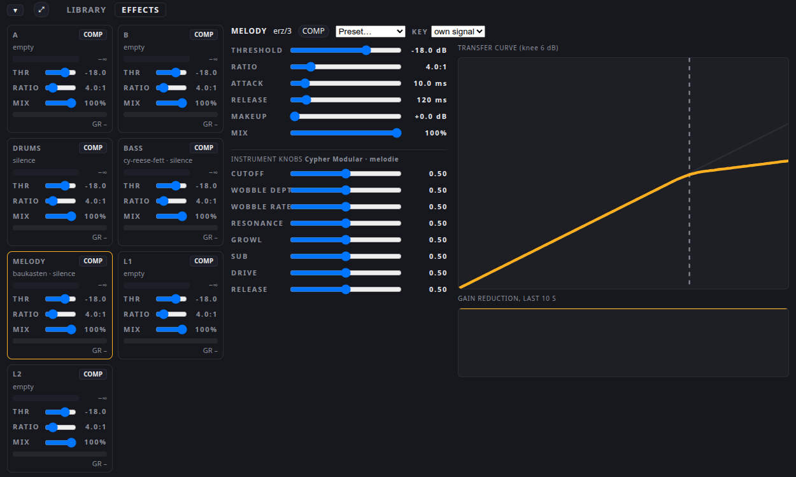
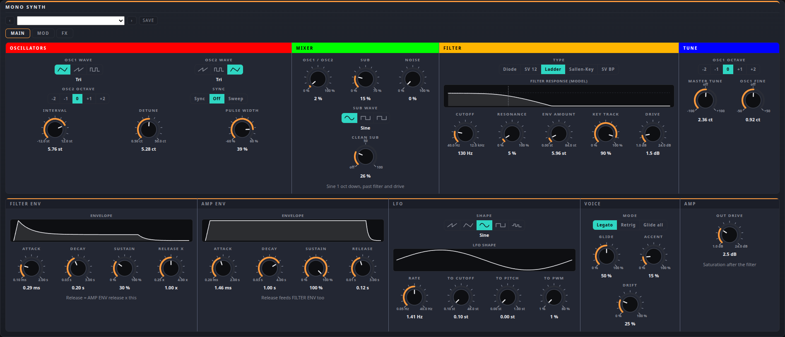

# Cypher Modular

A modular synthesizer, written in Rust (`djk/instruments/modular_dsp`) and built as a VST3 plugin with nih-plug
(`djk/instruments/modular`). It plays on the melody channel, and the core can also load a graph itself, so it sits in
other places too: on the bass channel, on five extra pattern streams, on production instrument tracks and as an effect
on DJ channels and send returns (see "Where a graph can sit"). Its patch is not a preset file of knob positions but a graph: building blocks and
the wires between them, in JSON.



## Install and run

```sh
djk/instruments/install.sh baukasten
djk/start/djk-instrumente --melodie baukasten
```

The host reads the patch from `~/.config/cypherdj/baukasten-melodie.json` each time it starts. Without that file it
plays the built-in `saege-ladder` patch; a broken file also falls back to it and logs `graph rejected, playing built-in`.

## A patch

The smallest example, `demos/saege-ladder.json`: a sawtooth through a ladder filter, shaped by an envelope.

```json
{
  "format": "baukasten/1",
  "name": "saege-ladder",
  "stimmen": 8,
  "knoten": [
    {"id": "note", "art": "note"},
    {"id": "osz", "art": "saege"},
    {"id": "filter", "art": "ladder"},
    {"id": "env", "art": "adsr", "a": 0.005, "d": 0.4, "s": 0.6, "r": 0.3},
    {"id": "vca", "art": "mul"},
    {"id": "aus", "art": "ausgang"}
  ],
  "kanten": [
    {"von": "note.hz", "nach": "osz.hz"},
    {"von": "osz.aus", "nach": "filter.x"},
    {"von": "note.gate", "nach": "env.gate"},
    {"von": "filter.aus", "nach": "vca.a"},
    {"von": "env.aus", "nach": "vca.b"},
    {"von": "vca.aus", "nach": "aus.x"}
  ]
}
```

(Shortened; the file in the repository also sets cutoff, resonance and levels.) The field names are German, like the
code: `knoten` are nodes, `kanten` are wires, `art` is the block type, `stimmen` the number of voices, `von` and
`nach` are from and to.

## The blocks

| Group | Blocks (`art`) |
|---|---|
| Notes and control | `note` (hz, gate, velocity, trigger), `konst`, `regler` (one of the knobs, mapped to a range, with an optional start value `vorgabe` and centre value `mitte`), `transponiere`, `glatt` (smoothing) |
| Oscillators and noise | `saege`, `puls`, `dreieck`, `sinus`, `rauschen`; the saw, pulse and triangle also take a band-limited hard sync input and output (`hart`) |
| Sound sources | `trommeln` (a drum kit in one block: the note picks the drum), `wavetable` (band-limited tables with up to seven detuned copies in one voice), `fm` (six operators, sixteen algorithms), `granular` (grains of a generated source), `resonator` (a modal bank of up to 32 modes per voice), `saite` (a digital waveguide string), `metall` (metallic oscillator bank for hi-hats and cymbals), `sampler` (plays a sample file), `paula` (a bank of up to 32 sample slots with latched slot, start and direction, in the manner of an Amiga voice), `lfsr` (console-style shift-register noise, long or short register), `notenwahl` (the note picks one of eight pads: the index for a selector, so a kit of Cypher Modular sounds is one graph) |
| Filters and shaping | `ladder`, `svf`, `allpass` (first or second order phase rotator), `schieber` (frequency shifter: every partial moves by the same number of Hz), `kreuz` (Linkwitz-Riley crossover with two or three bands), `saett` (saturation), `roehre` (one triode stage), `krume` (bit and sample rate reduction), `ms20` (low-pass and high-pass with saturating feedback), `sem` (12 dB state-variable filter that morphs from low-pass through notch to high-pass, plus a band-pass output), `diode` (diode-ladder low-pass), `kamm` (tuned feedback comb filter), `formant` (vowel filter of five parallel band-passes), `falter` (wavefolder with antialiasing and 2x oversampling), `labor` (Cypher Labor, see below), `lpg` (low-pass gate: a filter and amplifier opened by a model of a vactrol, fast to open and slow to close) |
| Modulation | `adsr`, `lfo`, `mseg` (multi-stage envelope, up to eight stages with curves, a sustain stage and a loop), `sh` (sample and hold, clocked by a trigger, in beats or in Hz), `folger` (envelope follower), `drift` (per-voice analog drift), `chaos` (a Lorenz or Roessler attractor as a never-repeating LFO with two outputs), `funktion` (a dual-slope function generator: envelope, slew limiter, LFO and audio oscillator in one block) |
| Arithmetic | `mul`, `add` |
| Effects | `chorus`, `phaser`, `hall` (reverb), `delay`, `faltung` (convolution with an impulse response file, no added latency), `vocoder` (11-band channel vocoder), `remix` (beat-synchronous remix station, see Cypher Remix below) |
| Dynamics | `limiter`, `gate`, `komp` |
| Wiring | `ausgang` (output), `eingang` (input, for effect graphs), `leitung` (a feedback path that can be wired freely), `wahl` (a selector over up to eight inputs, with a crossfade), `matrix` (a 16 by 16 pin matrix that routes sixteen sources to sixteen destinations, with two weight sets and a morph between them) |

The `sampler` block also has a zone mode, used by the multisample instruments of the STUDIO view: a table of up to 1024
zones over one memory-mapped sample pack of up to 2 GiB. A zone has a key range, a velocity range, a root note, gain
and pan, an optional sustain loop with a cross-faded wrap, and may be a release sample that plays on two outputs of its
own when the key is let go. Several zones for the same key and velocity alternate (round robin).

The `sampler` block plays a sample file of up to 60 seconds. Its slice mode, used by the Sampler of the STUDIO view, takes
a slice table `grenzen` (2 to 65 frame positions, so 1 to 64 slices of any length) and `noten_wahl` 1, in which the note
picks the slice: notes 0 to 63 play slices 0 to 63 forward, notes 64 to 127 play the same slice reversed, exact to the
sample. The read speed is `tempo` times two to the power of `halb` over twelve; both are inputs (`tempo` a factor, default
1; `halb` in semitones, default 0) and are taken at the start of each hit. A third input, `ausklang` (milliseconds,
default 5), is the release when the key goes up before the slice ends. Without these keys the block behaves as before.

A `regler` node can also carry `rastet` 1. That knob does not glide: it takes its value at once, and for an instrument
track a lane or envelope on it is read at the beat of each note, so every hit gets the value of its own step. The slice
device uses it for SPEED and PITCH.

That makes 62 block types. The graph is checked when it loads and runs in a fixed order. Feedback is only allowed through
a wire marked `"verzoegerung": 1` or through `leitung`. Up to 16 voices run side by side; the audio callback does not
allocate.

## Knobs

Each patch can use up to 64 knobs (`Knob 1` to `Knob 64`, values 0 to 1) and name them in `regler_namen`
(format `baukasten/2`). A `regler` node reads one of them and maps it
to a range, linear or logarithmic. On the page they appear in the expanded EFFECTS view of the channel (screenshot
above); the agent turns them through the same route (`/klang`). A `regler` node can carry a start value `vorgabe`
(the knob position a graph starts at, 0 to 1, default 0.5) and a centre value `mitte` (the value at knob position 0.5),
so a new knob can begin at "off" while older projects and presets keep their sound. The VST3 plug-in exposes 64 knob
parameters.

## Front panels

Each graph can ship a front panel (a plate) next to it: a JSON file that binds controls to knobs with real units,
selectors with waveform symbols, and envelope, LFO shape and filter curve displays. A graph without one gets an
automatic panel. The plate opens enlarged on a device page, with a live spectrum of the channel, and a preset picker
(PRESET) and a save button sit in its header. Presets can also be dragged from the PRESETS tab of the browser onto a track.



## Instruments built from the blocks

- **Mono Synth** (`synth-mono`): two oscillators with hard sync, a sub, noise, five switchable filters, filter and
  amplifier envelopes, a modulation envelope, two LFOs (the second with tempo sync and a choice of target), glide,
  velocity depth, tuning, drift, a Lorenz chaos LFO (rate, to cutoff, to oscillator 2 pitch), a clean sub that skips filters and
  effects, and chorus, delay and reverb.
- **Poly Synth** (`synth-poly`): eight voices, a unison stack of up to seven saws, a second oscillator, three filters,
  a modulation envelope, two LFOs, glide, velocity depth, tuning, drift, a chorus, wave position, warp, stack, phase modulation and a chaos source.
- **Greif** (`synth-greif`): a hybrid wavetable synth with eight voices. Three wavetable oscillators, each with a table of its
  own that travels through 20 to 24 timbres (analog to digital, vocal, bell and organ), bend each other's phase, can be warped
  (bend, asymmetric, sync) and unison-stacked; a clean sub that skips filters and effects, noise, two filters with a drive between
  them, an envelope, a triangle LFO and a Lorenz chaos source for slow movement, and chorus, frequency shifter and delay. Twelve
  factory presets.
- **Kraken** (`synth-kraken`): a semi-modular synth with four voices. An East half with two oscillators, ring modulation, noise,
  a sine modulator and four switchable filters (ladder, SEM, MS-20, diode), a West half with a sine, a wavefolder and a low-pass
  gate, two function generators, feedback from the output, two LFOs and a chaos source, delay and reverb. A 16 by 16 patch field
  (`matrix`) routes the sources to the destinations, with default pins and a morph to a second pin set; the cabinet view draws
  it as jacks and cables. Fourteen factory presets.
- **Neuro Bass** (`synth-neuro`): three detuned copies bent by FM, ring modulation and a wavefolder, seven switchable
  filters, a tempo-synced second LFO, sample and hold, a second oscillator, key follow, warp, stack, phase modulation, chaos, drift, delay and reverb.
- **Drums 909 and Drums 808** (`drums-909`, `drums-808`): two drum machines built on the `trommeln` block.
- **Drum Synth** (`drum-synth`): a kit of eight pads (kick, rim, snare, clap, low tom, closed hat, open hat, cymbal); every pad is a
  drum recipe of Cypher Modular with its own knobs, selected by the played note (`notenwahl` into a selector).
- **Filterbox** (`fx-filterbox`): an effect with six filter models and three modulation sources.
- **Cypher Labor** (`labor`, `fx-labor`): a two-channel feedback processor in one block: a model of a one-bit
  delay chip, a resonant filter whose resonance depends on the level, clipping, channel and cross feedback and one
  modulator, run sample by sample at twice the base rate. As an instrument a note pings both filters (key tracking,
  note gate, width); as an effect the left side runs through channel 1 and the right through channel 2. It is new and
  experimental: one listening session so far, no presets yet.
- **Cypher Remix** (`remix`, `fx-remix`): a beat-synchronous remix station in one block, after the public signal flow
  of a class of DJ remix hardware (no code, samples or presets of any device). Four sections: SCENE (one bipolar
  control: to the right five build-up effects, BPF echo, echo, noise, spiral up, reverb up; to the left five
  break-down effects, HPF echo, crush echo, LPF echo, spiral down, reverb down; a pump that ducks the effect on the
  beat), ISOLATE (three bands with cut/add, trans/roll, isolator and gate), PAD (a touch field in the beat grid that
  rolls the input or plays four synthesized drum voices, with an overdub pattern) and RELEASE (a lever that ends the
  sound with a brake, an echo or a back spin and returns to the original when let go). It loads neutral: with every
  section off it passes its input bit for bit, adds no latency and costs about 38 microseconds per block of 128
  samples. The FX3 unit of the mixer opens a Remix window with a lever and a touch field. New: tested on synthetic signals and
  in one demonstration session, the curves are the model's own choices.

The new controls of the three synthesizers were added without changing any old sound: with every new knob at its start
value, the graphs render byte for byte as before. Their numbers were measured on synthetic signals; the new controls have not
been judged by a listener yet. The three wavetable synths (`wavetable-reese`, `wavetable-supersaw`, `wavetable-chor`) were built out the same way: warp, stack and chaos, in part phase modulation, a clean sub, band drive and a chorus.

## Where a graph can sit

- the melody channel, as before, and the bass channel (the graph replaces that channel's sound, the pattern keeps
  playing through it);
- erz/5 to erz/7, erz/9 and erz/10, each as an instrument on its own pattern stream (start the studio with
  `djk/start/djk-start --strudel --bk-stroeme`); these streams can be recorded onto production tracks;
- a production instrument track (the device is the graph and its knob values; up to 16 such tracks), played from the
  project's notes live and in the offline render;
- an effect graph as an insert on a deck channel, on the DJ master sum, on a loop deck channel or on one of the three
  Strudel channels, or on one of two send returns (the examples `fx-*`: echo, spring reverb, filter ride, phaser,
  flanger, tube, vocoder, remix and others). A pattern channel holds one graph: an instrument or an effect.

The knobs of a graph on a channel can be learned onto a MIDI controller, and a project remembers which graph sits
on which channel with its knob values.

## Example patches

In `djk/instruments/modular_dsp/demos/`: `juno-pad` (eight voices, chorus; with reverb, echo or dynamics in the
`-hall`, `-echo` and `-dyn` variants), `lead` (sync lead), `bassmusik` (wobble bass with growl), `saite` (a plucked
string), `rueckkopplung` (a feedback patch), `saege-ladder`, and since then `fm-*` (bass, electric piano, bell, lead),
`wavetable-*` (supersaw, reese, choir), `granular-*`, `resonator-*`, `metall-*` (hi-hat, ride, crash), `saite-*`
(guitar, harp, piano, Karplus-Strong), `hartsync-*`, `sampler-fairlight`, `synth-mono`, `synth-poly`, `synth-neuro`, `drums-909`, `drums-808` and the `fx-*` effect graphs (among them `fx-filterbox`). 213 factory presets of our own devices ship with the preset browser, 165 of them for Cypher Modular graphs. Greif 2, the three Juno Pad variants and the sync lead example are no longer offered in the instrument pickers because they duplicate other graphs; they still load by name, and their sounds stay in the sound list. The folder
`rezepte/` holds 46 more, one per sub-type of the instrument vocabulary (bass 8, drums 5, fx 5, keys 6, lead 7, pad 6,
percussion 5, pluck 4), each built from a written recipe card.
