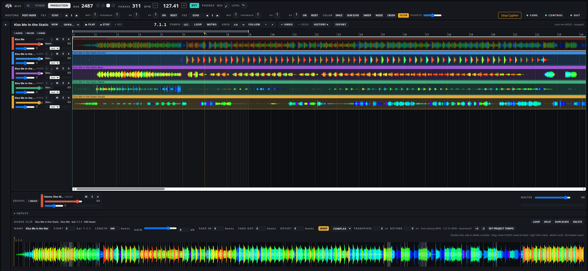

# cypher-dj in detail

The full list of what cypher-dj does, the instruments and effects of its own, what was measured and the known limits
of the beta. The short version is the [README](../README.md).

## What it does

**Play**
- Up to four decks with a beat grid, eight hot cues, loops, beat jump and quantized jumps (1/4 beat to 4 bars)
- 3-band EQ with kill, filter, channel faders, crossfader, master and headphone cue
- Beat FX on any channel or the master, timed in beats: echo, flanger, phaser, filter, reverb, delay,
  ping pong, trans, roll, slip roll, vinyl brake and spiral
- Sound color FX on each channel's COLOR knob, as on a Pioneer mixer: filter, space, dub echo, sweep, noise
  and crush
- A compressor on every source channel (threshold, ratio, knee, attack, release, makeup, parallel mix) with
  presets and an external sidechain, for example the kick ducking the bass
- A reverb send into Cypher Hall, our own spectral reverb (see below)
- Mix tools in the channel strip: a noise gate and a utility (balance, width, bass mono, DC block, channel swap, phase switches) on
  the source channels, a three-band multiband compressor on each of the four group buses (automatic make-up per band, so
  compressing a band does not make the mix quieter), an optional look-ahead limiter per bus (off until
  `kanal_limiter_vorhalt_ms` is set in `kern.toml`) and a spectrum analyser of 29 bands, three per octave, for one
  channel or the master
- A DJ view with four places: each place is empty or shows a track deck, the Strudel channels, a loop deck, a SEQ deck or the stems of a
  module (a fader and a mute per stem),
  switched only while that channel is silent (fader closed, no headphone cue); track place N is deck N. The layout is
  kept per browser. A track place folds to a mini view (position, overview, loop lengths, transport) and leaves its
  height to the other place of its column
- The four faders belong to the four places, not to what a place shows: place 1 is strip A, place 2 is B, place 3 is C,
  place 4 is D (the S8 and the APC20 keep their fixed assignment). Whatever stands in a place, a track, a SEQ deck, the
  Strudel sum or a loop deck, sounds through the fader of that place.
- The main mixer has four channel strips, A to D, around a middle column with the master, the
  headphones, beat FX 1 and 2 and COLOR. The Strudel channels have their strips inside the Strudel place, next to a
  SOUND column that picks the instrument of bass and melody (Surge XT or any Cypher Modular instrument) and shows its
  first four knobs; OPEN shows the full panel of that instrument in its own window
- Two loop decks, LOOP 1 and LOOP 2, each with four tracks of eight cells. A cell holds an audio loop or a one-shot; a
  click launches it on the next point of the launch grid (1/4 beat to four bars) and the cell that was playing on that
  track ends on the same point. Scene buttons start a whole row, a running loop can be re-entered at one of eight slices,
  and loop sets store a whole deck. Loops come from the library, from a module or stem, from the running loop of a track
  deck (LOOP and 1 2 3 4) or from the Strudel sum: a row in the Strudel place records the sum of the three channels into a
  loop deck track as a new cell. Each deck plays into the channel of the place that shows it and is refused where that
  channel is open, also for the agent, so nothing new starts audibly under your hands
- A channel strip per loop track, opened with STRIP: three-band EQ with kill, a HALL and a DELAY send that stay inside the
  deck's channel, and one effect slot (for example Remix or Crunch); a Traktor Kontrol S8 side can run its loop deck with
  pads, faders, dials and scene buttons
- Cypher Remix as FX3: a beat-synchronous remix station (build-up and break-down effects, a three-band isolator, a
  pad with roll and drum voices, a release lever) in its own window. Key 3 on a channel strip sends that channel
  through it, key 3 on the master sends all of them; the agent drives the same knobs
- SEQ, a pattern sequencer as a kind of place. A deck holds several patterns that play together; a pattern plays one
  instrument (a Cypher Modular instrument, a drum kit or the RB-338) and holds the lanes you add: note lanes (click a
  step, drag for velocity or length, wheel for pitch), value lanes (one knob value per step) and curve lanes (draw
  points or pick a shape such as sine, ramp or seeded random steps) on any knob of the instrument. Each lane has its
  own grid (4, 8, 16 or 32 per bar) and may have a shorter length, so it shifts against the notes. Two quick presses
  remove a value or a point. A pattern is an ordinary MIDI clip with envelopes, so PRODUCTION opens the same data in
  its piano roll. The agent writes a whole pattern in one call as text with the `seq` tool and reads the same text back
- SEQ scenes: the SCENES strip in the header stores up to eight pictures of which patterns play across all SEQ decks (SAVE, then a
  number). A click on a number switches the whole picture on the next bar line; with the transport stopped it switches at once
- A module from the workbench becomes a SEQ deck with one click (TO SEQ DECK in the workbench, or LOAD MODULE in the place): one
  pattern per instrument track with the same instrument, notes and knob values. Effects, sends and the key stay behind and the
  page says what was left out. It is one undo step.
- Three [Strudel](https://strudel.cc) pattern channels (drums, bass, melody). Strudel runs as its own
  process; the core plays the resulting events at the sample
- Real instruments: Surge XT hosted in Carla, played by the patterns
- One clock: decks, loop decks, patterns and effects are scheduled on the same sample counter in the core
- Multi-core audio: the real-time core keeps its one sample clock but no longer does everything on one thread. A DJ
  channel strip whose input is silent and whose effects are idle skips its DSP, with bit-equal output. In an
  arrangement the return Halls 2 to 8 are computed on up to seven worker threads, each pinned to its own physical core
  (`hall_faeden` and `hall_cpus` in `kern.toml`); a Hall that is not ready at its deadline is computed in the callback
  instead, and after repeated late blocks the pool switches itself off with the same sound and tries again after a back-off. `djk-start` gives the core
  four physical cores by default (`CYPHERDJ_KERN_KERNE`) and the remaining ones to stem separation
- Live master tempo from 60 to 200 BPM, ramped over a bar: the decks and the loop decks (key-locked,
  pitch kept), the pattern channels and recordings follow it

**Prepare**
- A workshop that reads a track once: loudness, key, tempo map and beat grid, then renders it to the set
  tempo so it is ready to play. The grid is snapped to the kick transients where they can be measured
  cleanly. On the two tracks checked against Ableton Live's warp markers (both measured against the same detected
  kick onsets), the median offset is about 1 ms. The spread from beat to beat is larger, and tracks that cannot be
  measured cleanly keep the raw grid
- A cue tool: a 3-band waveform of the whole track, hot cues set from the keyboard
- Import of grid and cues from a Traktor collection
- A library with sets that can be prepared ahead of time
- The library sits at the bottom of the DJ view. The arrow button or the key L folds it open or shut; the big browser (the expand button or the key G) shows the table with the LOAD A, B, 3 and 4 buttons that put a track on a deck
- The BROWSER button (or the key B) opens a drawer with seven sections: THIS PROJECT, PROJECTS, LIBRARY, INSTRUMENTS AND EFFECTS, PRESETS,
  KITS and COLLECTIONS. Files dropped on it are imported; a dropped folder is refused, ADD FOLDER takes a folder
- A media library browser for tracks, loops and one-shot samples: folder tree, full-text search, filters
  for key (with harmonic neighbours), BPM and energy, a waveform per item, headphone preview, and loops
  straight into a loop deck cell
- Key and energy analysis for the whole library, with BPM filled in where it was missing

**Produce** (since October 2026)
- A PRODUCTION view next to DJ and STUDIO: arrangement with a timeline, library browser, detail area for the selected
  clip, transport bar
- Named markers on the timeline of the PRODUCTION view (up to 64 per project): a click jumps the start marker there, Shift
  click loops from the marker to the next one (and so chooses the export range), double click renames, drag moves on
  the grid. The agent reads and writes them with the project
- A chord lane row under the ruler of the PRODUCTION view (CHORDS next to + MARKER, up to 512 entries): chord symbols or keys
  from a beat on, edited by double click, drag and Delete. A track whose MIDI FX Scale is Project key follows it, for clip notes
  and played keys. The lane is stored, sent with the playback and read by the engine. The agent writes it with the project
- Up to 128 tracks, 16 group tracks and 8 returns; every track goes to the production master or into a group, and groups
  can sit inside groups (a DRUMS group holding KICK, PERC and HATS groups, each with its own inserts, fader and sends)
- Audio tracks: drag a sample from the library onto a track; clips snap to the grid and can be moved, trimmed, split,
  duplicated, faded and looped inside their length
- **Edit tools**: an EDIT toolbar and a context menu split, glue, duplicate, copy, cut, paste and delete audio and MIDI
  clips, with the usual shortcuts (Ctrl+E, Ctrl+J, Ctrl+D, Ctrl+C, Ctrl+X, Ctrl+V, Del); paste also lands on another
  track
- **Warp**: an audio clip follows the project tempo. The warp markers come from the workshop's beat grid, a Traktor
  grid or the library BPM, and can be set, moved and deleted by hand in a sample editor (double or halve the tempo, set
  bar one here, warp from here, take the project tempo from the clip). Four modes: RE-PITCH (varispeed), COMPLEX and
  TONES (time-stretched with Bungee, pitch kept) and BEATS (slices at the grid or at the transients). Transpose from
  -12 to +24 semitones, detune by ±50 cents. Quantize Audio pulls the transients onto a 1/16 grid
- **Stems**: Separate Stems in a clip's menu splits it with BS-RoFormer on the GPU into drums, bass, other and vocals,
  plus guitar and piano when they carry signal (an empty stem is folded into other). Four to six tracks appear under the
  clip in a group, beat-exact, and the original is muted; one undo step takes it all back. The run shows its progress
  and can be cancelled. It needs a CUDA GPU, there is no CPU path
- **Note editor** for single-voice audio clips (a vocal, a lead, a bass line): Detect Notes finds the notes and shows
  them over the clip. Drag a note up or down to change its pitch (up to 24 semitones), drag it sideways to move it in
  time, or drag an edge to stretch it; time snaps to 1/16 of the clip grid, Alt frees it. A neighbour that touched the
  moved edge follows it, and a stretch beyond 0.25 to 4 times is refused. The context menu quantises the starts to
  1/16 and snaps the pitch to the project key or to semitones, both with a strength from 0 to 100 percent. Vibrato and
  drift of a note can be set from 0 to 400 percent of what was sung (100 leaves it as sung), and "Flatten vibrato" and
  "Flatten drift" set them to 0. Every gesture is one undo step, the clip plays the edit once it is rendered, and
  untouched parts stay bit-identical. The render measures each edited note in the result (a note too short or unvoiced has no entry) and reports how far it lands
  from its target pitch in cents; the agent reads this and the time and pitch offsets of each note with `proj_noten`
  and edits with `audio_noten_aendern` and `audio_noten_raster`
- Instrument tracks with the built-in RB-338, a Cypher Modular graph (up to 16 such tracks), a one-shot kit or Surge XT
  (two hosted slots; the patch is chosen from the Surge library and stored in the project); notes are drawn in a
  piano roll with velocity
- **Piano roll tools**: SNAP grids from 1/32 to a bar, with triplets; QUANTIZE onto the chosen grid with strength and
  swing; HUMANIZE for start and velocity with a new random shift per click; SCALE keeps drawn and moved notes in the
  key of the project. The agent has the same tools as the commands `noten_quantisieren` and `noten_humanisieren`
- **Instrument racks**: several instruments on one track with key and velocity zones and a chain selector, four macro
  knobs that drive parameters across the members, and stored variations of the macro settings
- Recording: arm audio tracks for an external input or one of the studio's own channels, and instrument tracks for
  MIDI in. Count-in, punch in and out, overdub, input monitoring, and takes placed with the latency compensated.
  Every pass is kept as a take
- **Takes and comping**: each take is its own lane under the track; drag a range on a take lane to comp it into the
  track with seam fades, and audition a single take. Instrument tracks have takes too: a MIDI recording with the loop on
  keeps every loop pass as a take lane
- **Routing**: group tracks that fold in the arrangement (Ctrl+G groups the selected tracks), a routing matrix
  for outputs, sends and sidechain keys, and resampling of any track, group, return or the master into a new audio
  track
- **Automation**: lanes per track for fader, pan, mute, solo and four RB-338 parameters, and lanes on the parameters
  of insert stages, on the four rack macros and on the knobs of a Cypher Modular track (up to 64), drawn with points or recorded
  from the hand (touch, latch or write). Grabbing a track's fader, pan, mute or solo by hand overrides its lane, which the
  page shows until the override is ended. Clips carry envelopes of their own (gain, transpose, relative track volume
  and pan). Groups, returns and the master have rows of their own for the parameters of their insert stages, and a
  return also for its fader. A track can automate the level of an existing send into a return as well (dB, tracks only,
  not groups; evaluated once per audio block, so a step is smoothed over up to 21 ms); a send lane is not grabbed by hand
- **Modulators**: an LFO with five shapes (sine, triangle, saw, square, random), tempo synced in bars and beats or free in
  Hz, or an envelope follower that follows the level of another track (attack, release and sensitivity; the pad ducks with
  each kick), that swings a target around its base value: a track fader, a track pan, a return fader, a knob of a Cypher
  Modular track, a send level, a parameter of an insert stage, a rack macro or a parameter of a plugin. Depth is set in the unit of the target (dB, pan units, a fraction of the knob), bipolar or unipolar, with a phase
  and a smoothing time so square and random steps do not click. The offset is added on top of whatever the target plays
  (value, lane, your hand), so turning the knob moves the centre while the sweep keeps running. Modulators run while the
  transport stands and are rendered the same way in the export; the faces of the compressor, saturator and limiter draw a
  ring on a modulated knob. Up to 16 modulators with 8 targets each per project; set them with "+ Mod" in the lane row of a
  track head, with "Mod" in an insert's popover and in the parameter rows of a plugin, or by the agent. The live value shows as a ring around the knob and a second marker on the fader and pan, and the agent reads it with `proj_auto` and a `mod_id`
- **MIDI FX**: a chain on an instrument track between notes and instrument, in a strip above the front panel of the device
  view: arpeggiator (seven patterns, rates 1/2 to 1/32 with triplets on the project grid or free in Hz, 1 to 4 octaves, gate),
  and chord, scale, velocity (curve, fixed, random) and chance, in the order chord, scale, arp, velocity, chance, with a seed
  that makes the random parts repeat. Clip notes, played keys and the agent's notes all go through it, the export renders it
  like the playback, and a recording keeps what you played. The agent reads per track how many notes went in and out
- **Inserts**: up to five stages per strip on a track, a group, a return and the production master, taken from a pool
  of our own devices: compressors, EQs, a saturator, a limiter, a utility (stereo width 0 to 4 and bass mono) and a
  Cypher Modular effect graph as a stage, with a tempo-synced delay return shipped as an example. Pre or post fader sends, a gain reduction readout
  per stage, delay compensation across tracks and groups, and a rack of four macro knobs per strip (up to 16 mappings
  per strip)
- **Third-party plugins** (VST3 and LV2, Linux builds; Windows plugins through yabridge and Wine): a plugin is an
  insert stage on any strip or the instrument of a track. Each plugin runs in its own host process, so a crashing or
  hung plugin makes its strip play dry (time-aligned, with a fade) instead of stopping the music. A crash-proof scan
  builds the plugin list (a plugin that crashes or hangs in the scan is listed as blocked, with its reason), the
  plugin's own window opens on the desktop, its state is stored in the project, and its latency is measured and
  compensated like that of our own devices. A project with an active plugin stage is exported in real time through the
  production master. The agent can list, insert, bypass and set the parameters of plugins; the scan and the plugin
  window stay with the human
- **Plugin parameters on lanes, knobs and a sidechain** (third-party effect plugins): any parameter of a plugin stage can
  be drawn as an automation lane in PRODUCTION (up to 16 per plugin stage, played at 50 Hz, so it is accurate to about
  10 ms, not to the sample). Up to 16 parameters of a plugin stage sit on controller knobs: the MIDI button on a
  parameter row picks the parameter, you move a knob or fader on any MIDI controller, and the assignment is stored in
  the project and the controller binding. A plugin with a sidechain input (four audio inputs, for example a
  compressor with an external key) takes a key from any track, group, return or deck, with the delay compensated like
  that of our own compressor. A VST3 bundle with several plugins lists every plugin as its own entry; they load through
  a small shim module that the install builds
- **Master meter (PRODUCTION)**: the transport bar shows the master output while it plays: momentary and short-term
  loudness, integrated loudness since RESET or since PLAY (with the distance to the export's loudness target), the
  highest true peak since RESET with an OVER mark against the target's ceiling (0 dBTP without one), and stereo
  correlation. It is measured from the output as heard, ten times a second, in the page server, not in the audio
  engine. A click on the correlation value opens a vectorscope of the output. A/B switches every stage of the
  production master off and on while the music plays. Both versions are measured once from an offline render of the
  loop range, and the louder one is turned down by the difference, so the comparison is at the same loudness. It is
  matched for that range, bypasses all master stages together, and is refused with a plugin stage or a fader lane on
  the master
- **Sidechain**: a compressor stage or an EQ stage with dynamic bands can be keyed (KEY button on the stage, or the agent's tools) by another track, a group, a
  return or a DJ deck; keys that would form a cycle or arrive too late are refused with a reason. One command sets up
  Duck by Kick
- **Sends and returns**: eight returns, each with one send per track or group and an optional Cypher Hall
- **MIDI import**: a Standard MIDI file (format 0 or 1) becomes one track with one MIDI clip per MIDI track and
  channel, with tempo and a preview before anything changes. The whole import is one undo step
- **Pattern to clip**: a [Strudel](https://strudel.cc) pattern written under the piano roll becomes an ordinary MIDI
  clip with notes and clip envelopes; nothing of Strudel runs at playback time. Generating again refuses to overwrite
  hand edits unless asked to
- **Merge and bounce**: merge two or more tracks into one new audio track, or bounce a track in place, to a new track
  or as a copy to paste, by an offline render of the same core. Tracks with insert stages are refused
- **Presets**: a browser for presets of our own devices (213 factory presets, your own, collections) with names from
  a closed vocabulary; drag one onto a track, a stage or a strip
- Tempo, loop range and metronome; the time signature of the project (2/4 to 12/4: bar counter, beat dots, ramps over bars and pattern starts count in that meter); per track volume, pan, mute, solo and a meter
- Projects are folders with a JSON file; every change is one undo step, and the undo history survives a restart
- Variants: tracks can share a group (say bass A, B, C); one click in the transport bar makes one of them audible
  and mutes the others, as a single undo step
- Per-track loudness: an offline render measures integrated LUFS, LRA and true peak of every track as it sits in the
  mix (mute and solo count as in the mix); the tracks add up to the export within 0.1 LU
- Stop Cypher hands the arrangement over instead of stopping it: what plays keeps playing, Cypher stops acting, and a
  start of Cypher's that is still waiting for its bar is dropped
- Export as an offline render by the same core that plays live. Hosted instrument tracks are frozen first, so the
  file matches what was heard (see [Measured](#measured)). Without a loop bracket the export takes the whole song.
  The master is always written: WAV, 48 kHz, 32 bit float
- Delivery files next to the master, made from it with ffmpeg: WAV (16 bit, 24 bit or 32 bit float), FLAC (16 or 24
  bit) or MP3 (192, 256 or 320 kbit/s constant bit rate), at 44.1, 48, 88.2 or 96 kHz (MP3 at 44.1 or 48 kHz). Up to
  four files per export. Sample rate conversion uses libsoxr, and a 16 bit file gets TPDF dither (or none, your choice)
- A loudness target (streaming: -14 LUFS and -1 dBTP, or a true peak ceiling alone) is a check on the master and on every
  delivery file, each measured on the file itself. Nothing is normalised: a true peak above the ceiling is a warning,
  the distance in LU is information
- Release metadata of the project (title, artist, album, year, genre, ISRC) goes into the delivery files, never into
  the master: WAV tags plus a BWF `bext` chunk, FLAC also with BPM and key, MP3 as ID3v2.3 with TSRC, TBPM and TKEY. Key
  and tempo are written only where the format has a place for them and the project key is a major or minor scale. A
  switch in the export dialog (`ohne_meta` for the agent) leaves the release tags out; ffmpeg still writes its own
  encoder tag
- The EXPORT dialog offers presets (Master only, Release: WAV 16 bit 44.1 kHz, Promo: MP3 320, Release and promo, Custom),
  the loudness target and the metadata. A second mode writes the mix and every track as one file each, in WAV or FLAC at
  the chosen depth and rate, with no tags. Delivery files move to the bin together with their master when old exports
  are tidied, and never count as exports
- The EXPORT dialog has an "Export to" row: any folder below your home folder or on a mounted disk instead of the
  export folder of the project (`ordner` for the agent), remembered between exports; SHOW FOLDER opens it
- The agent builds and edits the same projects through its own tools (create tracks, write clips and notes, warp,
  separate stems, automate, insert and key, comp, bounce, mix, start the transport, export). `proj_export` takes
  `abgabe`, `ziel` and `ohne_meta`, and `proj_export_spuren` writes the per-track set

**Measure before it is loud**
- A native headphone previewer, separate from the browser, which only draws
- The core measures every deck behind its closed fader: band energy, loudness, and overlap in the
  sub-bass with what is already playing
- A rule in the core: the agent may not open a deck that has not been measured first. The human may.

**Let an agent play along**
- "The hand": an [MCP](https://modelcontextprotocol.io) server with tools to load, cue, loop, set EQ and
  effects, write patterns and play instruments
- Some controls stay human-only: the headphone level, the deck transport, the AUTO switch, releasing Stop Cypher,
  proposals, MIDI learn, pairing and the plugin scan. Every other mixer control (crossfader, master, bus faders, effect
  routing) may be turned by the agent; a raise of the master, a bus fader or a loops or stems container fader by more
  than 6 dB has to be a ramp of at least one bar
- Any move by hand overrides the agent, and a stop control halts it
- Live scenes (`szene`): a snapshot of the live sound (patterns with their phase, stream labels, controls, graphs, FX,
  Surge states, running loop tracks) that comes back from the next bar, with the state before saved as `_vor_laden` so a
  restore can be undone. Stored setups (`aufbau`) add the tempo, the four container faders and the graphs of the Cypher
  Modular streams, live outside any project and rebuild the studio over 2 bars, also after a core restart
- A live harmony lane (`harmonie`): one repeating chord sequence such as `Am7 Dm7 G7 Cmaj7` that the Strudel streams follow.
  In a pattern, `.harm(octave)` plays scale degrees of the lane key and `.akkordton(octave)` the tones of the lane chord, so
  bass, pad and melody stay in one key. A change is one call and every stream lands on the same downbeat; the studio status
  counts the planned notes that lie outside the lane per stream
- Timed moves and arcs: a `spur` switches patterns of any pattern stream at a bar, and Strudel patterns fade with
  `.rein(n)` and `.raus(n)`. `bogen` compiles layers with entry and exit bars, fades and one break and drop into one such
  track, and `warte` can wait until a track is a number of bars before its end
- `mischung` listens to the master for a few bars and compares it with a rough curve for a genre (techno, house, deep house,
  dub, techstep, minimal). `stimme` turns phrase WAV files into a sliced voice loop on a channel. Every stream can carry a
  short label, shown on the channel strip row of the Strudel place with a level meter, a blink and the running arc
- In the conductor process, autonomy levels from 0 (observe only) to 3 (everything on its own). The
  default is 1: the agent loads, auditions and generates on its own, turns down its own track, and every other plan becomes a
  proposal you accept or reject. Level 2 behaves like level 1 for now. The start level is `autonomie_start` in `leitstand.toml`; no MCP tool sets it
- A skill for Claude Code in [`skills/djk-live/`](skills/djk-live/SKILL.md) that teaches an agent how to play
  *with* a human: think about what a move does before making it, crossfade instead of swapping, one change
  every 8 bars and announce it first. A second skill, [`skills/track-analysis/`](skills/track-analysis/SKILL.md), teaches how
  to measure a track's tempo, grid and phase and cut it into loops and one-shots that close cleanly. Copy a folder into the
  skills folder of Claude Code (`.claude/skills` in your home directory) to use it

## Own instruments and effects

Written in Rust, each as a DSP library plus a VST3 plugin (built with nih-plug), measured against
references before they went in:

- **Cypher EQ**: a parametric 8-band EQ (a filter bank of state-variable filters, 2x oversampled) whose
  curves follow the analog target curve up to 20 kHz within 0.27 dB, where a plain bilinear design is
  off by several dB near the top
  In the production core the EQ stage is also EQ Pro: a bell or shelf band can be dynamic (it cuts or boosts only above or
  below a threshold, up to a range, with attack and release per stage; in a key mode it listens to another track, a group,
  a return or a DJ input through the KEY button, so a bass shelf can duck only while the kick plays), the stage reports its deepest change, and a
  De-esser entry in the insert menu puts up the same stage as a dynamic high shelf for vocals
- **Cypher Hall**: a spectral reverb (energy decay per frequency bin, early reflections, frequency-wise
  ducking, freeze). It is the reverb on the send, the REVERB beat FX and the Hall of the arrangement's returns
- **Cypher Space** (`fx-space`): a convolution reverb with zero added latency and four rooms (hall, room, plate, chamber), your own
  impulse response from a file of a sample folder (up to 2 s, LOAD IR on the panel), pre-delay, low and high cut, width and a blend
  with the algorithmic reverb; eight factory presets. The four rooms are synthetic impulse responses, not recordings of real spaces.
  It was measured on probe signals and has not been judged by a listener yet
- **Cypher Comp**: a feed-forward compressor after Giannoulis, Massberg and Reiss (2012) with soft knee,
  parallel mix, external sidechain and a high-pass in the detector; six presets
- **Cypher Transient**: a transient shaper as an insert stage on any strip: one gain for the onset of a sound and one for the
  tail after it (each from -24 to +24 dB), a detector time of 1 to 100 ms, output level and dry/wet mix; no latency
- **Cypher Imager**: a three-band stereo imager as an insert stage: the width of the low, mid and high band is set apart
  (the low band can only be narrowed), both crossovers move, and everything below a chosen frequency can be made mono; no latency
- **Cypher Echo** (`fx-echo`): a character delay with seven synced divisions and a free time, high and low cut and drive
  inside the feedback, tape wow and flutter, ping-pong and ducking by the input; five factory presets
- **Cypher Saturation**: a tanh saturator with first-order antiderivative antialiasing (Bilbao et al. 2017)
  at 2x oversampling; on a hard-driven sawtooth the aliasing stays below -60 dB, against -50 dB without
  oversampling. Available as a plugin and as an insert stage in the production core.
  In the production core the stage also has soft and hard clip curves with a ceiling (-24 to 0 dBFS), so it works
  as the Cypher Clipper: the Clipper entry in the insert menu, and a CLIP button on the master strip that puts a
  clipper in front of the master limiter. The stage reports how far it goes over its ceiling
- **Cypher Drive** (`fx-drive`): an insert device with six curves (tape, tube, soft clip, hard clip, wavefolder,
  bit crush), drive, character, tone, output and mix, and a three-band mode with its own drive per band; six
  factory presets
- **Cypher Modular**: a modular synthesizer. A patch is a JSON graph of building blocks (oscillators, filters,
  envelopes, LFOs, chorus, reverb, delay, dynamics, free feedback paths and, among others, wavetable, FM, granular,
  modal resonator, string, sampler, filter, sample-and-hold, multi-stage envelope, wavefolder, drum kit and remix blocks; 62 block types in all) with up to 64 knobs that the human or the agent
  can turn; a knob can have a start value and a centre value of its own. It plays on the melody and bass channels, on extra pattern streams and on production instrument tracks, and it
  runs as an effect on DJ channels, the DJ master, the loop deck channels and send returns. Example patches: a Juno-style pad, a sync lead, a wobble bass, FM bells, a plucked string. See [docs/cypher-modular.md](cypher-modular.md)
- **RB-338**: a 303-style bass voice with cutoff, resonance, envelope, decay, accent and slide, playable
  from the bass pattern channel instead of Surge XT
- **Mono Synth, Poly Synth, Neuro Bass**: three synthesizers built as Cypher Modular graphs. Mono Synth has two
  oscillators with hard sync, a sub, five switchable filters, a filter and an amplifier envelope, a modulation
  envelope, two LFOs (the second with tempo sync and a choice of target), glide, velocity depth, tuning, drift, and
  chorus, delay and reverb. Poly Synth has eight voices, a unison stack, a second oscillator, three filters, the same
  modulation sources, glide, drift and a chorus. Neuro Bass has three detuned oscillator copies bent by FM, ring
  modulation and a wavefolder, seven switchable filters, a tempo-synced second LFO, sample and hold, a second
  oscillator, key follow, delay and reverb. Every knob added in the build-out of 12 November sits at "off" or at the
  old value when a project loads, so the factory presets made before it render byte for byte as before (a null test
  against the old graphs). On 18 November Mono Synth got a chaos LFO (to cutoff, to oscillator 2 pitch) and a clean sub, Poly Synth
  wave position, warp, stack, phase modulation and chaos, Neuro Bass warp, stack, phase modulation, chaos and drift, and the three
  wavetable synths (`wavetable-reese`, `wavetable-supersaw`, `wavetable-chor`) warp, stack, chaos and, in part, phase modulation, a
  clean sub, band drive and a chorus; at the start values every graph renders byte for byte as before
- **Band Drive Bass** (`bass-banddrive`): a bass for electro, neuro and reese. A wavetable and a bite voice run into a
  band split; the mids are folded and driven into a moving vowel filter, the sub stays clean and mono. 24 knobs, six
  factory presets (electro growl, neuro stab, wide reese, acid squelch, overdriven rock, clean sub grit)
- **Greif** (`synth-greif`): a hybrid wavetable synth. Three wavetable oscillators with their own spectra, phase
  modulation between them, warp, an octave stack, a chaos modulator, a frequency shifter and a clean sub. 63 knobs,
  eight voices, twelve factory presets
- **Greif 2** (`synth-greif2`): Greif with tables built for a strong Position (basic to buzz, formant growl, hard sync),
  phase modulation off at the start, the same twelve presets for an A/B. Since 18 November it is no longer offered in the
  instrument pickers (it counts as a duplicate of Greif); its sounds stay in the sound list and apply it
- **Drums 909 and Drums 808**: two complete drum machines in one graph each. One MIDI channel plays the whole kit, the
  note picks the drum, the knobs tune the kit, and one bus (drive and a DJ filter) closes it
- **Filterbox**: an effect graph with six filter models (ladder, diode, comb, vowel and others), three modulation
  sources (LFO, sample and hold, envelope follower) and a dry/wet mix
- **Cypher Chorus, Flanger, Phaser and Tremolo**: four modulation insert devices with free rate or tempo sync from 1/16 to 4 bars;
  the tremolo doubles as an auto-pan; sixteen factory presets

## More in the box

The lists above are the headline. Also in there:

- **Front panels**: every instrument channel has a plate on the page with knobs that show real units (seconds,
  hertz, semitones, percent), envelope, LFO shape and filter curve displays, MIDI learn on each control, and on Cypher Modular
  plates a preset picker and a save button in the header. Devices without a hand-made panel get an automatic one. Plates also sit on
  instrument tracks and Cypher Modular insert stages in PRODUCTION, and automatically on host plugins. A Surge XT quick
  panel (50 parameters) has a button that opens the real Surge window
- **Device page**: the plate of an instrument enlarged over the page, with a live spectrum of the channel
- **Tablet**: the device page as a touch view with large knobs and faders on a tablet in your home network. It is off
  until switched on in a config file, each tablet is paired with a link that works for two minutes, paired devices expire
  30 days after last use, and a tablet cannot start or stop playback, change projects or evaluate code

- **Loop workbench (STUDIO)**: modules of up to eight instrument tracks that loop together over 1 to 128 bars. The
  tracks sit on the left (level, mute, solo, meter and one send knob per loaded effect), the sequencer takes the rest,
  and a dock below shows one card per instrument track and one per effect with a few knobs of the device; OPEN shows
  the whole device in a floating window. Up to eight effects are loaded into the dock and fed by the sends, each track
  has an insert chain of up to five effects, an instrument can be swapped while its notes stay, and a shelf drawer
  holds the saved modules (SAVE AS keeps a copy, DELETE moves a module to a bin folder). EXPORT WAV and EXPORT MIDI
  write the module as a sum and per track
- **Step sequencer (STUDIO)**: on a drum track every row has its own length, so rows of different length drift
  against each other, its own swing, a direction (forward, or forward and back) and SHIFT buttons that move its hits
  by a step. Per step: velocity, chance, offset and roll (several hits inside one step), shown in the step and
  changed by dragging. Tools DRAW, ERASE and FILL, Shift draws a line, Ctrl selects a range, the arrow keys move a
  cursor; 4, 8 or 16 steps per bar, pages of 1, 2 or 4 bars, and a loop range dragged above the steps
- **Sampler (STUDIO)**: cut a library loop, or the loop or a stem of a module, into up to 64 slices, by grid or at the
  hits found in the audio, and play them from a new instrument track in their original order. The SLICE grid has one
  row per slice, so reordering, repeating, shortening, reversing and pitching single steps are ordinary note edits. A
  strip shows the waveform with numbered slices, how strong each hit is and how far it sits from the grid; markers can be
  dragged (they snap to a hit or the grid), added and removed, and CUT AGAIN keeps your patterns. Selected slices become
  a drum kit (TO KIT, then KIT TO TRACK) or a tone that plays at the pitch of the keys, with a proposed root note (TO
  TONE). The shelf tab CUTS lists the cuts to reuse or delete. The agent does the same through its `sampler` tool. A kit
  made from hits plays on its own track at once but reaches the live drum stream only after a restart
- **Sample player (STUDIO)**: the shelf tab SAMPLES browses your own sample folders (the roots marked for the shelf in
  `~/cypherdj/quellen.toml`, edited in the SOURCES dialog) with a search over folder and file names; a click plays a file, TO TRACK
  puts it on a new instrument track that plays it across the keys, with the root note from pitch detection and the
  file name. Folders without samples are hidden and every folder shows how many it holds
- **Media browser in the shelf (STUDIO)**: the SAMPLES tab has a LIBRARY mode next to FOLDERS. It searches the one-shot
  catalog by text and by instrument class, hides protected samples, lists files you can reach first and names a disk
  that is not mounted. A star marks a favourite, and a sample put on a track counts as recently used; both are fixed
  collections that also sort the DJ library and the PRODUCTION library. A row can be dragged onto the track list (a
  new instrument track) or onto a row of a drum kit track, which copies the kit with that sound replaced and leaves
  the old kit untouched
- **One search over the shelf (STUDIO)**: a field above the shelf tabs searches samples, loops, instruments, devices, presets,
  modules and cuts at once and groups the hits by kind, five rows each with "show all". The rows are the ones of the
  tabs, so preview, star, TO TRACK and the rest work from the hits. FITS keeps the catalog samples and loops that match
  the tempo of the open module (also half or double) and a key next to its key. `/` jumps to the field, Escape clears it.
- **Storage layout and collecting (STUDIO)**: everything you make lives in one visible folder, `~/cypherdj/`, and
  every source folder is named once in `~/cypherdj/quellen.toml`, which the SOURCES dialog of the shelf edits. A project
  copies its sources from a removable disk into its own `audio/` folder when it opens, and COLLECT in PRODUCTION does it
  for every outside source (copies only, each checked by sha256, never while music plays). Three exports per project
  stay, older ones move to a bin; the decoded audio cache and the waveform cache have size caps. `djk-umzug` moves an
  existing install over, one kind at a time and reversibly
- **Multisample instruments (STUDIO)**: a folder of note samples becomes one instrument (INSTRUMENT TO TRACK): note,
  velocity layer and take are read from the file names, so every key gets the nearest sample, the velocity picks the
  layer and takes alternate (round robin). Loop points stored in WAV or AIFF files become sustain loops with a
  cross-fade, and a sibling folder of release samples plays when a key is let go, with its own level knob. Built
  instruments are kept on the shelf tab INSTRUMENTS. The sample data of an instrument is one memory-mapped pack of up
  to 2 GiB
- **ANALYZE window (STUDIO)**: measures a track, a group, a return or the master, and optionally a second one, from a
  render of the loop range (also while the loop plays): a spectrum in semitone bands with the column under the
  playhead, a time picture, stereo correlation and width in four bands, loudness (LUFS-I, short-term and momentary
  maxima, LRA, true peak, crest), the masking between the two strips and objective hints (a bass that is not mono, a
  true peak over -1 dBTP, a narrow resonance, two strips fighting in the bass). A reference can take the place of the
  second strip: a track or sample dragged from the shelf, or a reference curve stored by role (SAVE REF); the
  reference is level-matched and the largest differences in tonal balance are named. The source LIVE OUTPUT shows the
  master output as it plays (spectrum with held maximum, rolling picture, stereo with a vectorscope, momentary loudness, true peak).
  FIND MASKING renders every sounding track once, compares all pairs and lists the worst conflicts, each with a proposed
  EQ cut on the quieter strip and an APPLY button (one undo step).
  Where a source has narrow resonances, TAME RESONANCES puts up to three dynamic EQ bands on them (they cut only while the peak
  sounds), also in one undo step.
  The agent reads the same numbers with the tools `proj_analyse`, `analyse_referenz` and `analyse_live`
- **FIND SOUND window (STUDIO)**: finds a sound together with you instead of handing you a preset. For the Cypher
  Modular instrument of the selected track it measures neighbours of the current sound that differ in exactly one
  knob, keeps three that are audibly different from it and from each other, and names each by what it does (brighter,
  more sub, more movement, shorter ...). The places A to D switch while the loop plays (click or keys 1 to 4) without
  changing the project; PICK writes the chosen one as one undo step and looks for its neighbours, NEW NEIGHBOURS
  offers others, three step sizes (subtle, clear and strong say how far a variant must differ from the current sound; a knob is turned
  further until that is reached, and one that cannot get there is offered at its end stop and marked "max"). COMPARE alternates one bar of
  the current sound and one bar of the variant at the same loudness. Every pick is kept as a path on the track: BACK returns one step, a click on any
  earlier step goes there and a new pick from it starts a branch. The agent drives the same round with the tool
  `klang_runde`
- **Step lanes for knobs (STUDIO)**: `+ lane` under the grid adds a step lane for any knob of a Cypher Modular
  instrument; clicking a key or a drum row plays it
- **Effects section**: one strip per channel showing what plays and how much the compressor pulls, an
  expanded view with every control, a MASTER tab in signal order (insert effect, glue compressor, limiter with a gain reduction
  meter), and automation per loop for compressor, filter, hall send and EQ
- **Resampling**: record the master into the loop library (1 to 32 beats, starting on the beat), cut a
  running deck loop sample-exact into a loop deck cell, or turn a recorded loop into a Strudel sound
  (`s("rec0")`) that the drum channel can play right away
- **Sounds**: browse, load and save Surge XT patches for the bass and melody channels
- **Mixer details**: per-channel trim, a glue compressor on the master, effect routing post-fader or
  insert, a headphone cue/master blend, level meters per channel
- **Grid by hand**: nudge a track's grid, set bar one on the real downbeat, and keep it for that track
- **Cue pads** as jump cues or loop cues, quantized to the grid
- **Sets**: collect tracks for a planned set and prepare all of them in one go
- **Extra pattern streams**: five more channels (erz/5 to erz/7, erz/9 and erz/10) can each carry a Cypher
  Modular graph, started with `djk-start --strudel --bk-stroeme`; they can be recorded onto production tracks. The
  graph knobs can be learned onto a MIDI controller, and a project remembers which graph sits on which channel
- **The agent's side**: 120 tools in the MCP server. Besides playing it can measure a deck behind its
  closed fader, read the levels of the last seconds, wait on the master clock for a number of bars, run
  automation tracks and ramps over bars, and cancel everything it started. The MCP tools have no proposal call: a plan
  is offered as a proposal through the conductor (`djk-spiel plan`), and the human accepts or rejects it with one key.
  Every agent call carries a key with a level (read, write, full); the person can stop all agent writes with one
  button, destructive calls wait while music plays, and every call is logged.
- **Cue tool**: key and BPM filters with a harmonic-mix option (±1 on the Camelot wheel), named cues,
  4-, 8- and 16-bar loops, quantize, and taking over existing Traktor cues

## Hardware controllers

Three ways in. The first two need no configuration of the device itself beyond plugging it in.

- **Fixed desks.** A small bridge program binds three devices to fixed layouts. The Akai APC20 is the console for the four DJ
  channels and the master, and while the main window shows PRODUCTION it is the project mixer (below). The Traktor Kontrol S8
  works the DJ view: two screens with a scrolling waveform, hot cue marks, a whole-track overview and the Strudel, loop and SEQ
  views, hot cue pads, loop and browse encoders, touch strips (tempo bend while playing, scratch when stopped, SHIFT seeks in
  whole beats), and PLAY and LOOP lights that follow the deck. The Maschine MK2 is a desk for Cypher Modular knobs: group
  buttons choose a channel, the top buttons a page of eight knobs, the encoders turn them, and the displays show the knob names
  and values.
- **Controller places.** Any class-compliant MIDI controller can be learned. There are eight places, each with its own learn
  table, so two devices that send the same control do not collide. The CONTROLLERS window lists every device and every
  assignment, shows known devices as tiles in their own layout (Akai LPD8 with its four programs, Novation Launch Control 3),
  and assigns a control to any continuous target, or a button or pad to a switch or a deck action. A Maschine Jam and a
  Pioneer XDJ-XZ are known but not bound.
- **Tablet.** The device page as a touch view (see above).

**Following the synth in front.** With FOLLOW on for a place, the knobs of the selected instrument are put on the controls of
that device and move with you when you select another one. A project track in PRODUCTION or in the workbench, a pattern of a
SEQ deck or a live channel in INSTRUMENTS all count. Factory presets ship for the Launch Control 3, one program set per instrument panel (among them Mono Synth,
Poly Synth, Neuro Bass and the three wavetable synths). The LPD8 files for those six synths are still empty, so an LPD8 follows
a synth only with a layout you saved yourself. SAVE MAPPING keeps your own layout for a synth and FOLLOW prefers it.
An entry of such a preset can be valid on any MIDI channel. A knob of a project track turned on a controller is written into the
project after a short rest, as one undo step labelled Controller, except where a lane or a clip envelope drives it.

**Launch Control 3.** A preset can hold several programs, each an assignment of the 16 encoders and 8 buttons cut along the
boxes of the front panel of one synth. Page up and Page down step through them, the display shows the program, the buttons step
choice fields such as waveform or filter type, the LEDs carry the colour of the panel box a control belongs to, and the values
go back to the endless encoders so that they carry on from the real value.

**Keys.** The keys and pads of a MIDI keyboard play the instrument in front: the selected project track (armed for MIDI by the
studio while it is in front, nothing written into the project) or a live channel. A note assigned to a button in the learn
table is a button, not a key. One KEYS line in the CONTROLLERS window switches it.

**Device window.** `#geraet=<track>` opens the front panel of one instrument track in a window of its own, for a second
monitor. It follows the track in front (or stays on its track), shows the controls of every controller that drives the track in
the layout of the device, and offers LEARN and SAVE MAPPING.

**APC20 as project mixer.** While PRODUCTION is shown, faders 1 to 8 move the tracks of a bank of eight, the master fader the
project master, and Activator, Solo/Cue and Record Arm are mute, solo and arm with their lights. Shift with Play or Stop
starts or stops the arrangement, with Left or Right it steps the bank and with Up or Down the track in front. The bank is framed
in orange, and the track the controllers drive carries a yellow frame with CTL. In every other view the APC20 is the DJ console.

Not confirmed on the devices, only by tests that inject MIDI or by unit tests in the core: the Shift functions of the APC20 in
PRODUCTION (taken from a description of the device), mute, solo, arm and the steps of bank and track, the value feedback to the
endless encoders, the display text, the button lights and the step buttons of the Launch Control 3, and keys reaching a live
channel. Faders of the APC20 and the Page buttons of the Launch Control 3 were tried on the units. Controllers reach the first
sixteen Cypher Modular tracks of a project only. A Launch Control 3 in its fixed default mode sends on another channel and does not
match the factory presets. The first press of a step button after a restart or a preset change starts from the value of the
row, not from the project's value.

## Measured

Every number has a date. Measured on the development machine, often under load from other work,
mostly against a silent test sink. Not benchmarks.

| What | Result | Date |
|---|---|---|
| Previewer, command to first sample at the sink | median 8.3 ms over 20 plays (no real audio interface) | 2026-09-26 |
| Previewer, jumps | 8 of 8 targets sample-accurate | 2026-09-26 |
| Waveform of a whole track | 608 ms first time, 32 ms from cache (median of 10 tracks) | 2026-09-26 |
| Key detection | 76.7 % exact and 82.5 % within a neighbouring key, compared with Mixed In Key on 120 held-out tracks | 2026-09-26 |
| Production export against live playback (3 tracks: audio loop, RB-338, frozen Surge XT, 32 beats) | residual peak -200 dBFS, i.e. sample-identical; shifting one track by a single sample turns the test red | 2026-10-17 |
| Audio callback p99.9 with an arrangement playing, quantum 256 | 642 to 789 µs over three runs; 755 to 904 µs with exports rendering in parallel | 2026-10-17 |
| Stems against the warped original (real track, beats 16 to 48, at 124 and 128 BPM), measured with the previous separator, Demucs | warp markers 0.000 samples apart, frame count exact, one undo restores the project exactly | 2026-10-31 |
| Audio callback while GPU stem jobs run next to it (back-to-back BS-RoFormer jobs, arrangement with four Halls playing, quantum 256 and 128) | no frame gaps and no xruns | 2026-11-07 |
| Return Halls on worker threads (arrangement with four Halls, USB audio interface) | callback p99.9 lower at quantum 256 and 128, no xruns | 2026-11-06 |

## Known limits of the beta

- **Decks keep their pitch at any master tempo, in real time, including during a tempo ramp.** After each
  deck event (start, jump, hotcue) a bridge of about 0.1 s plays in varispeed until the stretcher takes over.
  A deck started by hand does not start while a tempo change is pending or ramping: from the moment the tempo
  changes until the end of its one-bar ramp, which begins on the next downbeat.
- Linux with PipeWire (JACK API) only, tested on Ubuntu 24.04 and 26.04 (the package smoke test runs on both). Pro-Audio device profiles cannot be
  used as outputs yet.
- The headphone path has been checked for signal and level on one USB DAC; its latency and unplugging and
  replugging a device have not been measured.
- Bar-one (downbeat) detection is unreliable; set bar one by hand where it is wrong.
- The instrument round trip (core to Surge XT and back, about 11 ms) is compensated by sending notes early;
  the value was measured against the real instrument at one audio buffer size (256 frames); the offset scales
  with the buffer size and has been checked in software at 128 and 512.
- Human and agent are told apart by a label on localhost. That is a convention, not a security boundary.
  Do not expose the ports to a network. The optional tablet access is the one exception: it listens on your
  home-network address only when switched on, and every request except the one-time pairing link needs a pairing cookie.
- Agent keys separate agents from each other, not from other programs of the same user: any program of that user can
  read the key file or act as the person at the machine.
- The measurement rule covers decks; the pattern channels are deliberately exempt.
- Stem separation needs an NVIDIA GPU with CUDA and about 4.5 GB of free video memory; there is no CPU path, and without
  a GPU the request is refused. Up to 600 s of source per run. The weights of the model are downloaded from their
  Hugging Face repository (checked by sha256), which does not state a license for them: see
  [THIRD_PARTY.md](../THIRD_PARTY.md) before any commercial use.
- Stems are not sample-identical to the warped original: summed after warping they left a residual of about -8 dB when
  measured with the previous separator (31 October, not repeated with BS-RoFormer), so do not play them together with
  the unmuted original.
- An energy fingerprint and cue suggestions are planned for the workshop, not built. An
  experimental cue-suggestion pipeline is included as a separate research tool.
- Key detection is weak on major keys (the test library is almost all minor).
- Learning from the human's judgement is planned, not built.
- The build-out of the synthesizers (12 and 18 November) was measured on synthetic signals; its new controls have not been judged
  by a listener yet. The Cypher Modular VST3 plug-in exposes all 64 knob parameters.
- Production: two hosted instrument slots (Surge XT or a third-party plugin). Our own insert devices come from a
  pool per project: 160 compressors and 160 EQs (one of each for every track, group, return and the master), 4 saturators, 8 limiters, 8 utilities, 16 gates and 8 three-band compressors, at most five stages per strip. Third-party
  plugins: at most eight effect hosts at a time, at most 16 lanes and 16 controller knobs per plugin stage (lanes
  change in steps of 20 ms, not sample-accurate), a sidechain key only for plugins with four audio inputs, no CLAP, a
  multi-plugin VST3 bundle needs the shim module from the install (without it only its first plugin loads), and a
  project with an active plugin stage takes as long to export as the song lasts. The limiter stage detects true peaks (4x oversampled), and on the master chain it sits before the production master fader. Automation lanes cover fader, pan, mute,
  solo, four RB-338 parameters, insert stage parameters, the rack macros and Cypher Modular knobs. Takes and comping work on audio and instrument tracks; MIDI takes
  come from a recording over a loop (one take per pass); bounce and merge refuse a track that has insert stages. Export
  is refused while the transport is running. The live track meters show sample peaks; loudness per track is measured offline.
  The master meter measures the master output as heard, so a playing deck or the set limiter is included; its
  integrated value counts only what was measured while the page or the agent read it. A/B on the master is matched
  from one offline measurement of the loop range, not continuously.
- Export formats: delivery files are WAV, FLAC and MP3 only, with no cover art, no OGG, Opus or AAC. No loudness
  normalisation: a target only reports, and the mix is never changed. Dither exists at 16 bit only. The files of a
  per-track set do not add up exactly to the mix, because each one passes the master chain alone. The per-track set is
  not available while a plugin stage is on.
- Time signatures are n/4 only, 2/4 to 12/4. Eighth meters such as 6/8 and 7/8 are not built: the denominator is fixed at 4.
- The mix tools are costly at their maximum: with every gate, utility, multiband and limiter switched on at once, with
  true peak, the callback did not hold its cost gate in most runs of 60 s (2026-11-03). With the tools off, with the limiters
  built, or with a typical setting it held the gate in every run.
- The multi-core paths were measured on one 8-core machine. The channel limiters on the DJ buses are off by default.
- Sounds saved from a loop into the pattern channels play at their recorded speed, and parameter rides on the
  hosted instrument keep their duration in seconds; neither follows tempo changes yet.
- Sample instruments: 16 voices per instrument, no streaming from disk (a pack is memory-mapped, so the first notes
  after a reboot may read from disk), no sustain pedal, no cross-fades between velocity layers or keys, and instruments
  are not levelled against each other. Instrument definitions of other products (SFZ, sampler patches) are not read,
  and samples in a protected vendor format are not listed. Built and measured on 16 November, not yet judged by a
  listener.
- Many moving parts: Rubber Band, JACK/PipeWire, ffmpeg, Node.js 22.18+, Python, and optionally
  Strudel, Carla and Surge XT. See [INSTALL.md](../INSTALL.md).
- The library search expects a catalog database that is not part of this repository.
- Code comments are in German. The architecture docs and ADRs are written in German and published here as English translations; the export refuses to publish a translation whose German source has changed since. Field names and code words in the docs stay German (`regler`, `warp_setzen`). The interface is in English.

## Journeys

Six chapters walk through the features that make up 1.0. Each one is also run as an automated tour against the software, so the chapter and the program are held against each other.

- [Journey 0: bring your own sounds](journeys/j0-own-sounds.md): from a folder of samples to a kick you hear in a drum track
- [Journey 1: DJ](journeys/j1-dj.md): two files to a recorded mix
- [Journey 2: play a live set](journeys/j2-live-set.md): loops, a Strudel pattern, a SEQ pattern and scenes without a dropout
- [Journey 3: make a song in PRODUCTION](journeys/j3-production.md): an empty project to a WAV file
- [Journey 4: design a sound](journeys/j4-sound-design.md): one sound from a fresh project to a saved preset and back into a second project
- [Journey 5: let an agent play the studio](journeys/j5-agent.md): connect an agent, see what it can do, take a control back, Stop Cypher

## Labs

Some features are built but not yet proven, or are not offered as a finished part of 1.0. They are marked **LAB** (tooltip: "experimental, may change") wherever the page has a control for them. They can change or be removed without notice. A feature is part of 1.0 only if one of the journeys (see [the six journeys](journeys/j0-own-sounds.md)) checks it; everything else is labs.

Features with a control in the page:

- Prepared sets (free collections of tracks for a planned set)
- Collections (named lists of samples, presets, devices)
- FX unit 3: the remix graph as insert on any channel
- Take a running deck loop into a loop cell
- Loop sets (saved arrangements of cells)
- Strudel pattern library
- Export a deck loop as a live module, stems follow in the background
- Module library: save a group, insert it into a project
- Send a module into the SEQ deck
- Tracker view: song as sections of rows over instrument tracks
- Tracker: import of MOD files
- Takes and comping (audition, comp lanes)
- Foreign plugins (VST3, LV2) hosted through Carla in their own processes
- Plugin parameter learning and panels
- ANALYZE window (a view of the analysis)
- FIND SOUND: a variant round to improve a Cypher Modular sound
- Remix device (graph on the FX 3 insert)
- Traktor S8 (HID, displays, LEDs, loop deck mode) (its row in the CONTROLLERS list)
- Akai LPD8 (its row in the CONTROLLERS list)
- Novation Launch Control 3 (its row in the CONTROLLERS list)
- Maschine MK2 through the `cypherdj-pult` bridge (its row in the CONTROLLERS list)
- Tablet pairing (control from a tablet)
- XDJ-XZ and Maschine Jam bindings (its row in the CONTROLLERS list)

Labs features without a control in the page (hardware, operations, or only reachable by name or through the agent tools):

- What fits after this track (tempo, genre, Camelot move)
- Never-silent fallback (emergency lane when a source fails)
- Tags, RELATED items and saved searches in the browser (tools `tags` and `verwandt`)
- Beat FX tuned for the XDJ control scheme
- Scene follow actions (field `folge`)
- Export a loop cell as a module or to the workshop
- A loop as a Strudel sound (rec0, rec1, ...)
- Blend a module stem between original and new instrument path
- Adapt a module to the key of the master deck
- Live dock with module cards
- Launchpad Mini MK3 as SEQ grid
- Tracker: keyboard entry, selection, sections, text view
- Tracker: FX column and instruments shelf
- Time signatures n/4 (2/4 to 12/4)
- Time signatures 6/8, 7/8 and other eighths (not built, see Known limits)
- Own panels for plugins (instead of the generic parameter list)
- Windows plugins through yabridge and Wine
- Native Instruments (Kontakt) route
- Stem separation of an audio clip (drums, bass, other, vocals; BS-RoFormer on the GPU)
- Loudness per track, offline on request
- Analysis of a strip, comparison to a reference measurement
- Structure and cue suggestion pipeline
- Stream bounce: record a Cypher Modular instrument into a project in one call
- Several channel inputs (audio interface profiles)
- Cypher Labor (experimental block)
- Device tool `geraete_lage` (audio and MIDI inputs)
- Demo overlay on the page (`ansage`)
- Agent skills shipped with the public package (`djk-live`, `track-analysis`)
- Command-line player for the agent (`player_cli`)
- Emergency guide
- Fast test tier (`fast.py`: only the tests a change touches)
- Akai APC20: PRODUCTION functions with Shift
