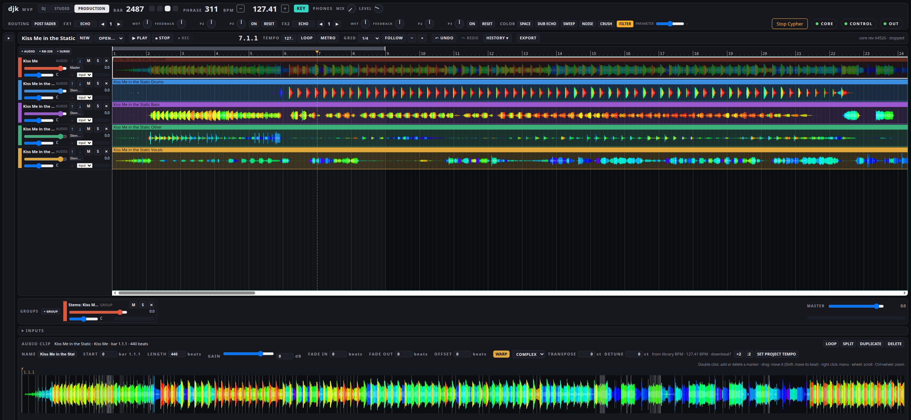

# cypher-dj in detail

The full list of what cypher-dj does, the instruments and effects of its own, what was measured and the known limits
of the beta. The short version is the [README](../README.md).

## What it does

**Play**
- Up to four decks with a beat grid, eight hot cues, loops, beat jump and quantized jumps (1/4 beat to 4 bars)
- 3-band EQ with kill, filter, channel faders, crossfader, master and headphone cue
- Beat FX on any channel or the master, timed in beats: echo, flanger, phaser, filter, reverb, delay,
  ping pong, trans, roll, slip roll, vinyl brake and spiral
- Sound color FX on each channel's COLOR knob, as on a Pioneer mixer: filter, space, dub echo, sweep, noise
  and crush
- A compressor on every source channel (threshold, ratio, knee, attack, release, makeup, parallel mix) with
  presets and an external sidechain, for example the kick ducking the bass
- A reverb send into Cypher Hall, our own spectral reverb (see below)
- Mix tools in the channel strip: a noise gate and a utility (balance, width, bass mono, DC block, channel swap, phase switches) on
  the source channels, a three-band multiband compressor on each of the four group buses (automatic make-up per band, so
  compressing a band does not make the mix quieter), an optional look-ahead limiter per bus (off until
  `kanal_limiter_vorhalt_ms` is set in `kern.toml`) and a spectrum analyser of 29 bands, three per octave, for one
  channel or the master
- Two loop boxes that record, resample and play back in time
- A DJ view with four places: each place shows a track deck, the Strudel channels or the loop slots, switched only
  while that channel is silent (fader closed, no headphone cue); track place N is deck N. The layout is kept per
  browser
- Loop slots L1 and L2: a loop cut from a deck (or loaded by the agent) becomes a live module with its stems and MIDI
  and plays on its own DJ channel with EQ, filter, fader and crossfader side. Placing a module into a slot whose
  channel is open is refused, also for the agent, so nothing new starts audibly under your hands. Each slot shows the
  waveform of its loop with a beat grid, bar numbers and the playhead of the live transport
- Cypher Remix as a fourth kind of place: a beat-synchronous remix station (build-up and break-down effects, a
  three-band isolator, a pad with roll and drum voices, a release lever) put as an insert on the master, a deck, a
  loop slot or one Strudel channel, chosen in the place; the agent drives the same knobs
- Three [Strudel](https://strudel.cc) pattern channels (drums, bass, melody). Strudel runs as its own
  process; the core plays the resulting events at the sample
- Real instruments: Surge XT hosted in Carla, played by the patterns
- One clock: decks, loop boxes, patterns and effects are scheduled on the same sample counter in the core
- Multi-core audio: the real-time core keeps its one sample clock but no longer does everything on one thread. A DJ
  channel strip whose input is silent and whose effects are idle skips its DSP, with bit-equal output. In an
  arrangement the return Halls 2 to 4 are computed on up to three worker threads, each pinned to its own physical core
  (`hall_faeden` and `hall_cpus` in `kern.toml`); a Hall that is not ready at its deadline is computed in the callback
  instead, and after repeated late blocks the pool switches itself off with the same sound. `djk-start` gives the core
  four physical cores by default (`CYPHERDJ_KERN_KERNE`) and the remaining ones to stem separation
- Live master tempo from 60 to 200 BPM, ramped over a bar: the decks and the loop boxes (key-locked,
  pitch kept), the pattern channels and recordings follow it

**Prepare**
- A workshop that reads a track once: loudness, key, tempo map and beat grid, then renders it to the set
  tempo so it is ready to play. The grid is snapped to the kick transients where they can be measured
  cleanly. On the two tracks checked against Ableton Live's warp markers (both measured against the same detected
  kick onsets), the median offset is about 1 ms. The spread from beat to beat is larger, and tracks that cannot be
  measured cleanly keep the raw grid
- A cue tool: a 3-band waveform of the whole track, hot cues set from the keyboard
- Import of grid and cues from a Traktor collection
- A library with sets that can be prepared ahead of time
- A media library browser for tracks, loops and one-shot samples: folder tree, full-text search, filters
  for key (with harmonic neighbours), BPM and energy, a waveform per item, headphone preview, and loops
  straight into a loop box
- Key and energy analysis for the whole library, with BPM filled in where it was missing

**Produce** (since October 2026)
- A PRODUCTION view next to DJ and STUDIO: arrangement with a timeline, library browser, detail area for the selected
  clip, transport bar
- Up to 32 tracks, 16 group tracks and 4 returns; every track goes to the production master or into a group, and groups
  can sit inside groups (a DRUMS group holding KICK, PERC and HATS groups, each with its own inserts, fader and sends)
- Audio tracks: drag a sample from the library onto a track; clips snap to the grid and can be moved, trimmed, split,
  duplicated, faded and looped inside their length
- **Warp**: an audio clip follows the project tempo. The warp markers come from the workshop's beat grid, a Traktor
  grid or the library BPM, and can be set, moved and deleted by hand in a sample editor (double or halve the tempo, set
  bar one here, warp from here, take the project tempo from the clip). Four modes: RE-PITCH (varispeed), COMPLEX and
  TONES (time-stretched with Bungee, pitch kept) and BEATS (slices at the grid or at the transients). Transpose from
  -12 to +24 semitones, detune by ±50 cents. Quantize Audio pulls the transients onto a 1/16 grid
- **Stems**: Separate Stems in a clip's menu splits it with BS-RoFormer on the GPU into drums, bass, other and vocals,
  plus guitar and piano when they carry signal (an empty stem is folded into other). Four to six tracks appear under the
  clip in a group, beat-exact, and the original is muted; one undo step takes it all back. The run shows its progress
  and can be cancelled. It needs a CUDA GPU, there is no CPU path
- Instrument tracks with the built-in RB-338, a Cypher Modular graph (up to 8 such tracks), a one-shot kit or Surge XT
  (two hosted slots; the patch is chosen from the Surge library and stored in the project); notes are drawn in a
  piano roll with velocity and 1/16 quantize
- **Instrument racks**: several instruments on one track with key and velocity zones and a chain selector, four macro
  knobs that drive parameters across the members, and stored variations of the macro settings
- Recording: arm audio tracks for an external input or one of the studio's own channels, and instrument tracks for
  MIDI in. Count-in, punch in and out, overdub, input monitoring, and takes placed with the latency compensated.
  Every pass is kept as a take
- **Takes and comping**: each take is its own lane under the track; drag a range on a take lane to comp it into the
  track with seam fades, and audition a single take. Audio tracks only
- **Routing**: group tracks that fold in the arrangement (Ctrl+G groups the selected tracks), a routing matrix
  for outputs, sends and sidechain keys, and resampling of any track, group, return or the master into a new audio
  track
- **Automation**: lanes per track for fader, pan, mute, solo and four RB-338 parameters, and lanes on the parameters
  of insert stages, on the four rack macros and on the knobs of a Cypher Modular track (up to 64), drawn with points or recorded
  from the hand (touch, latch or write). Grabbing a track's fader, pan, mute or solo by hand overrides its lane, which the
  page shows until the override is ended. Clips carry envelopes of their own (gain, transpose, relative track volume
  and pan)
- **Inserts**: up to four stages per strip on a track, a group, a return and the production master, taken from a pool
  of our own devices: compressors, EQs, a saturator, a limiter, a utility (stereo width 0 to 4 and bass mono) and a
  Cypher Modular effect graph as a stage, with a tempo-synced delay return shipped as an example. Pre or post fader sends, a gain reduction readout
  per stage, delay compensation across tracks and groups, and a rack of four macro knobs per strip (up to 16 mappings
  per strip)
- **Third-party plugins** (VST3 and LV2, Linux builds; Windows plugins through yabridge and Wine): a plugin is an
  insert stage on any strip or the instrument of a track. Each plugin runs in its own host process, so a crashing or
  hung plugin makes its strip play dry (time-aligned, with a fade) instead of stopping the music. A crash-proof scan
  builds the plugin list (a plugin that crashes or hangs in the scan is listed as blocked, with its reason), the
  plugin's own window opens on the desktop, its state is stored in the project, and its latency is measured and
  compensated like that of our own devices. A project with an active plugin stage is exported in real time through the
  production master. The agent can list, insert, bypass and set the parameters of plugins; the scan and the plugin
  window stay with the human
- **Sidechain**: a compressor stage can be keyed by another track, and through the agent's tools also by a group, a
  return or a DJ deck; keys that would form a cycle or arrive too late are refused with a reason. One command sets up
  Duck by Kick
- **Sends and returns**: four returns, each with four sends per track or group and an optional Cypher Hall
- **MIDI import**: a Standard MIDI file (format 0 or 1) becomes one track with one MIDI clip per MIDI track and
  channel, with tempo and a preview before anything changes. The whole import is one undo step
- **Pattern to clip**: a [Strudel](https://strudel.cc) pattern written under the piano roll becomes an ordinary MIDI
  clip with notes and clip envelopes; nothing of Strudel runs at playback time. Generating again refuses to overwrite
  hand edits unless asked to
- **Merge and bounce**: merge two or more tracks into one new audio track, or bounce a track in place, to a new track
  or as a copy to paste, by an offline render of the same core. Tracks with insert stages are refused
- **Presets**: a browser for presets of our own devices (103 factory presets, your own, collections) with names from
  a closed vocabulary; drag one onto a track, a stage or a strip
- Tempo, loop range and metronome; per track volume, pan, mute, solo and a meter
- Projects are folders with a JSON file; every change is one undo step, and the undo history survives a restart
- Variants: tracks can share a group (say bass A, B, C); one click in the transport bar makes one of them audible
  and mutes the others, as a single undo step
- Per-track loudness: an offline render measures integrated LUFS, LRA and true peak of every track as it sits in the
  mix (mute and solo count as in the mix); the tracks add up to the export within 0.1 LU
- Stop Cypher hands the arrangement over instead of stopping it: what plays keeps playing, Cypher stops acting, and a
  start of Cypher's that is still waiting for its bar is dropped
- WAV export as an offline render by the same core that plays live. Hosted instrument tracks are frozen first, so the
  file matches what was heard (see [Measured](#measured)). Without a loop bracket the export takes the whole song
- The agent builds and edits the same projects through its own tools (create tracks, write clips and notes, warp,
  separate stems, automate, insert and key, comp, bounce, mix, start the transport, export)

**Measure before it is loud**
- A native headphone previewer, separate from the browser, which only draws
- The core measures every deck behind its closed fader: band energy, loudness, and overlap in the
  sub-bass with what is already playing
- A rule in the core: the agent may not open a deck that has not been measured first. The human may.

**Let an agent play along**
- "The hand": an [MCP](https://modelcontextprotocol.io) server with tools to load, cue, loop, set EQ and
  effects, write patterns and play instruments
- Some controls stay human-only: crossfader, master, headphone cue, bus faders and effect routing
- Any move by hand overrides the agent, and a stop control halts it
- In the conductor process, autonomy levels from 0 (observe only) to 3 (transitions on its own). The
  default is 1: the agent suggests, the human decides
- A skill for Claude Code in [`skills/djk-live/`](skills/djk-live/SKILL.md) that teaches an agent how to play
  *with* a human: think about what a move does before making it, crossfade instead of swapping, one change
  every 8 bars and announce it first. A second skill, [`skills/track-analysis/`](skills/track-analysis/SKILL.md), teaches how
  to measure a track's tempo, grid and phase and cut it into loops and one-shots that close cleanly. Copy a folder into the
  skills folder of Claude Code (`.claude/skills` in your home directory) to use it

## Own instruments and effects

Written in Rust, each as a DSP library plus a VST3 plugin (built with nih-plug), measured against
references before they went in:

- **Cypher EQ**: a parametric 8-band EQ (a filter bank of state-variable filters, 2x oversampled) whose
  curves follow the analog target curve up to 20 kHz within 0.27 dB, where a plain bilinear design is
  off by several dB near the top
- **Cypher Hall**: a spectral reverb (energy decay per frequency bin, early reflections, frequency-wise
  ducking, freeze). It is the reverb on the send, the REVERB beat FX and the Hall of the arrangement's returns
- **Cypher Komp**: a feed-forward compressor after Giannoulis, Massberg and Reiss (2012) with soft knee,
  parallel mix, external sidechain and a high-pass in the detector; six presets
- **Cypher Saett**: a tanh saturator with first-order antiderivative antialiasing (Bilbao et al. 2017)
  at 2x oversampling; on a hard-driven sawtooth the aliasing stays below -60 dB, against -50 dB without
  oversampling. Available as a plugin and as an insert stage in the production core
- **Cypher Modular**: a modular synthesizer. A patch is a JSON graph of building blocks (oscillators, filters,
  envelopes, LFOs, chorus, reverb, delay, dynamics, free feedback paths and, among others, wavetable, FM, granular,
  modal resonator, string, sampler, filter, sample-and-hold, multi-stage envelope, wavefolder, drum kit and remix blocks; 52 block types in all) with up to 64 knobs that the human or the agent
  can turn; a knob can have a start value and a centre value of its own. It plays on the melody and bass channels, on extra pattern streams and on production instrument tracks, and it
  runs as an effect on DJ channels, the DJ master, the loop slots and send returns. Example patches: a Juno-style pad, a sync lead, a wobble bass, FM bells, a plucked string. See [docs/cypher-modular.md](cypher-modular.md)
- **RB-338**: a 303-style bass voice with cutoff, resonance, envelope, decay, accent and slide, playable
  from the bass pattern channel instead of Surge XT
- **Mono Synth, Poly Synth, Neuro Bass**: three synthesizers built as Cypher Modular graphs. Mono Synth has two
  oscillators with hard sync, a sub, five switchable filters, a filter and an amplifier envelope, a modulation
  envelope, two LFOs (the second with tempo sync and a choice of target), glide, velocity depth, tuning, drift, and
  chorus, delay and reverb. Poly Synth has eight voices, a unison stack, a second oscillator, three filters, the same
  modulation sources, glide, drift and a chorus. Neuro Bass has three detuned oscillator copies bent by FM, ring
  modulation and a wavefolder, seven switchable filters, a tempo-synced second LFO, sample and hold, a second
  oscillator, key follow, delay and reverb. Every knob added in the build-out of 12 November sits at "off" or at the
  old value when a project loads, so the factory presets made before it render byte for byte as before (a null test
  against the old graphs)
- **Drums 909 and Drums 808**: two complete drum machines in one graph each. One MIDI channel plays the whole kit, the
  note picks the drum, the knobs tune the kit, and one bus (drive and a DJ filter) closes it
- **Filterbox**: an effect graph with six filter models (ladder, diode, comb, vowel and others), three modulation
  sources (LFO, sample and hold, envelope follower) and a dry/wet mix

## More in the box

The lists above are the headline. Also in there:

- **Front panels**: every instrument channel has a plate on the page with knobs that show real units (seconds,
  hertz, semitones, percent), envelope, LFO shape and filter curve displays, MIDI learn on each control, and on Cypher Modular
  plates a preset picker and a save button in the header. Devices without a hand-made panel get an automatic one. Plates also sit on
  instrument tracks and Cypher Modular insert stages in PRODUCTION, and automatically on host plugins. A Surge XT quick
  panel (50 parameters) has a button that opens the real Surge window
- **Device page**: the plate of an instrument enlarged over the page, with a live spectrum of the channel
- **Tablet**: the device page as a touch view with large knobs and faders on a tablet in your home network. It is off
  until switched on in a config file, each tablet is paired with a link that works for two minutes, paired devices expire
  30 days after last use, and a tablet cannot start or stop playback, change projects or evaluate code

- **Studio view**: the three Strudel channels side by side, each with an automation lane for fader,
  filter and cutoff over 4 to 32 bars
- **Effects section**: one strip per channel showing what plays and how much the compressor pulls, an
  expanded view with every control, and automation per loop for compressor, filter, hall send and EQ
- **Resampling**: record the master into the loop library (1 to 32 beats, starting on the beat), cut a
  running deck loop sample-exact into a loop box, or turn a recorded loop into a Strudel sound
  (`s("rec0")`) that the drum channel can play right away
- **Sounds**: browse, load and save Surge XT patches for the bass and melody channels
- **Mixer details**: per-channel trim, a glue compressor on the master, effect routing post-fader or
  insert, a headphone cue/master blend, level meters per channel
- **Grid by hand**: nudge a track's grid, set bar one on the real downbeat, and keep it for that track
- **Cue pads** as jump cues or loop cues, quantized to the grid
- **Sets**: collect tracks for a planned set and prepare all of them in one go
- **Extra pattern streams**: five more channels (erz/5 to erz/7 and the two loop box pads) can each carry a Cypher
  Modular graph, started with `djk-start --strudel --bk-stroeme`; they can be recorded onto production tracks. The
  graph knobs can be learned onto a MIDI controller, and a project remembers which graph sits on which channel
- **The agent's side**: 90 tools in the MCP server. Besides playing it can measure a deck behind its
  closed fader, read the levels of the last seconds, wait on the master clock for a number of bars, run
  automation tracks and ramps over bars, and cancel everything it started. When it has an idea while the
  human plays, it proposes; the human accepts or rejects with one key
- **Cue tool**: key and BPM filters with a harmonic-mix option (±1 on the Camelot wheel), named cues,
  4-, 8- and 16-bar loops, quantize, and taking over existing Traktor cues

## Measured

Every number has a date. Measured on the development machine, often under load from other work,
mostly against a silent test sink. Not benchmarks.

| What | Result | Date |
|---|---|---|
| Previewer, command to first sample at the sink | median 8.3 ms over 20 plays (no real audio interface) | 2026-09-26 |
| Previewer, jumps | 8 of 8 targets sample-accurate | 2026-09-26 |
| Waveform of a whole track | 608 ms first time, 32 ms from cache (median of 10 tracks) | 2026-09-26 |
| Key detection | 76.7 % exact and 82.5 % within a neighbouring key, compared with Mixed In Key on 120 held-out tracks | 2026-09-26 |
| Production export against live playback (3 tracks: audio loop, RB-338, frozen Surge XT, 32 beats) | residual peak -200 dBFS, i.e. sample-identical; shifting one track by a single sample turns the test red | 2026-10-17 |
| Audio callback p99.9 with an arrangement playing, quantum 256 | 642 to 789 µs over three runs; 755 to 904 µs with exports rendering in parallel | 2026-10-17 |
| Stems against the warped original (real track, beats 16 to 48, at 124 and 128 BPM), measured with the previous separator, Demucs | warp markers 0.000 samples apart, frame count exact, one undo restores the project exactly | 2026-10-31 |
| Audio callback while GPU stem jobs run next to it (back-to-back BS-RoFormer jobs, arrangement with four Halls playing, quantum 256 and 128) | no frame gaps and no xruns | 2026-11-07 |
| Return Halls on worker threads (arrangement with four Halls, USB audio interface) | callback p99.9 lower at quantum 256 and 128, no xruns | 2026-11-06 |

## Known limits of the beta

- **Decks keep their pitch at any master tempo, in real time, including during a tempo ramp.** After each
  deck event (start, jump, hotcue) a bridge of about 0.1 s plays in varispeed until the stretcher takes over.
  A deck started by hand does not start while a tempo change is pending or ramping: from the moment the tempo
  changes until the end of its one-bar ramp, which begins on the next downbeat.
- Linux with PipeWire (JACK API) only, tested on Ubuntu 24.04. Pro-Audio device profiles cannot be
  used as outputs yet.
- The headphone path has been checked for signal and level on one USB DAC; its latency and unplugging and
  replugging a device have not been measured.
- Bar-one (downbeat) detection is unreliable; set bar one by hand where it is wrong.
- The instrument round trip (core to Surge XT and back, about 11 ms) is compensated by sending notes early;
  the value was measured against the real instrument at one audio buffer size (256 frames); the offset scales
  with the buffer size and has been checked in software at 128 and 512.
- Human and agent are told apart by a label on localhost. That is a convention, not a security boundary.
  Do not expose the ports to a network. The optional tablet access is the one exception: it listens on your
  home-network address only when switched on, and every request except the one-time pairing link needs a pairing cookie.
- The measurement rule covers decks; the pattern channels are deliberately exempt.
- Stem separation needs an NVIDIA GPU with CUDA and about 4.5 GB of free video memory; there is no CPU path, and without
  a GPU the request is refused. Up to 600 s of source per run. The weights of the model are downloaded from their
  Hugging Face repository (checked by sha256), which does not state a license for them: see
  [THIRD_PARTY.md](../THIRD_PARTY.md) before any commercial use.
- Stems are not sample-identical to the warped original: summed after warping they left a residual of about -8 dB when
  measured with the previous separator (31 October, not repeated with BS-RoFormer), so do not play them together with
  the unmuted original.
- An energy fingerprint and cue suggestions are planned for the workshop, not built. An
  experimental cue-suggestion pipeline is included as a separate research tool.
- Key detection is weak on major keys (the test library is almost all minor).
- Learning from the human's judgement is planned, not built.
- The build-out of the three synthesizers was measured on synthetic signals; its new controls have not been judged
  by a listener yet. The Cypher Modular VST3 plug-in exposes all 64 knob parameters.
- Production: two hosted instrument slots (Surge XT or a third-party plugin). The pools of our own insert devices are
  small: 12 compressors, 8 EQs, 4 saturators, 2 limiters and 8 utilities per project, at most four stages per strip. Third-party
  plugins: at most four effect hosts at a time, no sidechain into a plugin, no automation or controller mapping of
  plugin parameters, no CLAP, a multi-plugin VST3 bundle loads only its first plugin (use the LV2 version), and a
  project with an active plugin stage takes as long to export as the song lasts. The limiter works
  on sample peaks, not true peaks, and on the master chain it sits before the production master fader. Automation lanes cover fader, pan, mute,
  solo, four RB-338 parameters, insert stage parameters, the rack macros and Cypher Modular knobs. Takes and comping are for audio
  tracks; bounce and merge refuse a track that has insert stages. Export
  is refused while the transport is running. The live track meters show sample peaks; loudness is measured offline (per
  track or in the export).
- The mix tools are costly at their maximum: with every gate, utility, multiband and limiter switched on at once, with
  true peak, the callback did not hold its cost gate in most runs of 60 s (2026-11-03). With the tools off, with the limiters
  built, or with a typical setting it held the gate in every run.
- The multi-core paths were measured on one 8-core machine. The channel limiters on the DJ buses are off by default.
- Sounds saved from a loop into the pattern channels play at their recorded speed, and parameter rides on the
  hosted instrument keep their duration in seconds; neither follows tempo changes yet.
- Many moving parts: Rubber Band, JACK/PipeWire, ffmpeg, Node.js 22.18+, Python, and optionally
  Strudel, Carla and Surge XT. See [INSTALL.md](../INSTALL.md).
- The library search expects a catalog database that is not part of this repository.
- Code comments are in German. The architecture docs and ADRs are written in German and published here as English translations; the export refuses to publish a translation whose German source has changed since. Field names and code words in the docs stay German (`regler`, `warp_setzen`). The interface is in English.

