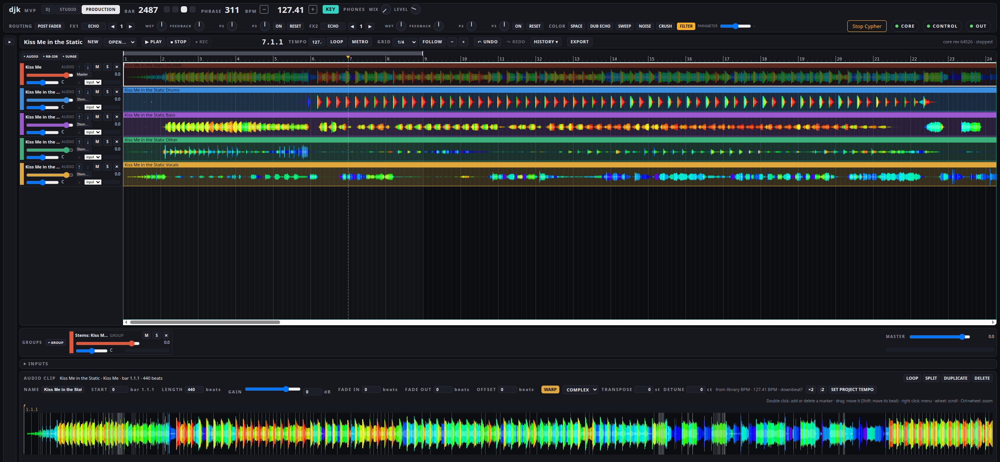
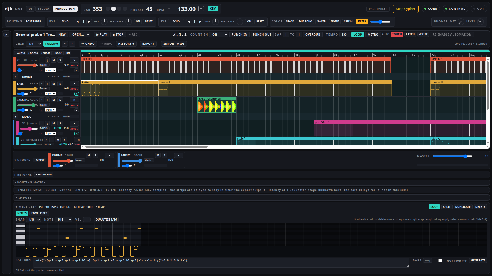

# Production, warp and stems

The PRODUCTION view sits next to DJ and STUDIO. It is an arrangement: tracks on a timeline, a library browser on the
left, a detail area for the selected clip below, a transport bar on top. The same real-time core that plays the DJ set
plays the arrangement, on the same sample clock.

## Tracks, groups, returns, master

Up to 32 tracks, 8 group tracks and 4 returns. Every track goes to the production master or into one group. Audio tracks
take samples and tracks dragged from the library; instrument tracks play the RB-338, a Cypher Modular graph (up to 8 such
tracks) or one hosted Surge XT. Per track: volume, pan, mute, solo, a meter. Every change is one undo step, and the undo
history survives a restart.

A return takes sends from every track and group (four sends per strip, taken after the fader and pan) and can carry
Cypher Hall: pre-delay, decay, size, low factor, high cut, tail. A return can also take its sends before the fader of
their source (the PRE and POST switch on the return).

## Warp

An audio clip with warp on follows the project tempo, also through tempo changes.

- **Where the markers come from**: in this order, the workshop's analysis of the track (beat grid snapped to the kick),
  a Traktor grid, the bar count of a loop, the library BPM. A long track without an analysis is warped from the best
  source at once and refined when the analysis arrives, as long as the clip is not playing.
- **By hand**: the sample editor shows the clip's waveform with its markers and, in grey, the detected transients.
  Double click adds or deletes a marker, dragging moves it (with Shift its beat). Further: double or halve the tempo,
  Set 1.1.1 Here (bar one at this spot), Warp From Here (straight from here, or start here), Set Project Tempo from the
  clip.
- **Modes**:
  - RE-PITCH: varispeed, pitch follows the tempo
  - COMPLEX: time-stretched with Bungee (grain 512), pitch kept
  - TONES: the same with a shorter grain (256)
  - BEATS: the clip is cut into slices at the grid (1/4 to 1/32) or at the transients, each slice starts on its beat;
    the gap after a slice can stay silent or be filled forwards or forwards and back, with a fade
- **Transpose and detune**: -12 to +24 semitones and ±50 cents (not in RE-PITCH).
- **Quantize Audio**: moves the transients onto a 1/16 grid, as one undo step.

## Stems

Right click an audio clip, Separate Stems. BS-RoFormer (the BS-RoFormer-SW model) splits the clip's source range on the
GPU into drums, bass, other, vocals, guitar and piano. Drums, bass, other and vocals are always placed. Guitar and piano
are placed only when they are not more than 45 dB below the input; otherwise their signal is added to other, so the sum
still equals the separation. The run needs a CUDA GPU with at least 4.5 GB of free video memory (set
`CYPHERDJ_STEMS_GPU_FREI_MB` to change that threshold); if there is none, or the memory runs out, the run ends with
`keine_gpu` or `gpu_belegt` and the project stays untouched. There is no CPU path. The menu shows the progress (Cancel
Stems, 26 %) and a cancelled run leaves the project untouched. When it is done, four to six audio tracks appear under the
clip in a new group, each stem warped exactly like the original, and the original is muted. One undo step takes all of it
back. Up to 600 s of source.

On 7 November 2026, back-to-back stem jobs ran next to the real-time core with an arrangement of four Halls playing, at quantum 256 and at 128: no frame gaps and no xruns. That is why the stem run is allowed while a set plays.

How the stems sit against the original was measured on 31 October 2026 on a real track at 124 and 128 BPM, with the
previous separator (Demucs): the warp markers of the stems sit 0.000 samples from the original's, the frame count is
exact, one undo restores the project exactly. It was not repeated with BS-RoFormer.

Limits:
- No GPU, no stems. Weights: about 700 MB, downloaded from their Hugging Face repository and checked by sha256. That
  repository does not state a license for them.
- Summed after warping, the stems left a residual of about -8 dB against the warped original when measured with the
  previous separator (the warp starts each clip with its own phase). The stems are coherent with each other; together
  with the unmuted original they can comb.

## Inserts, sidechain, macros

Each track, group, return and the production master has an insert chain of up to four stages. A stage is one of our own
devices from a pool that the whole project shares: 12 compressors, 2 EQs, 1 saturator and 1 limiter. The chain of a
return sits after its Hall, the chain of the master before the master fader (so the export carries it). A bypass is a
10 ms blend; every stage shows its gain reduction. Stages that add latency (EQ and saturator 69 samples, limiter 74
samples at 48 kHz) are compensated across tracks and groups, up to 1024 samples per place. The limiter looks ahead 1.5 ms
and works on sample peaks: a clip whose master sum peaks at +2.969 dBFS renders at -1.001 dBFS with a ceiling of
-1 dBFS. Because the master chain runs before the master fader, the ceiling holds with the fader at 0 dB or below.

A compressor can be keyed by another track (the Key selector on the stage). Through the agent's tools and in the project
file it can also be keyed by a group, a return, a DJ deck (1 to 4) or the drum channel; a key that would depend on the
stage itself or that is computed later than the stage is refused with a reason (`sidechain_zyklus`, `sidechain_spaet`,
`sidechain_quelle`). One command, Duck by Kick, adds a compressor stage with the values of the Kick Sidechain preset
(threshold -30 dB, ratio 8, knee 0, attack 1 ms, release 150 ms) keyed by a kick track.

A strip with a chain can have a rack of four macro knobs; a macro drives continuous parameters of the stages from a start
to an end value, up to 16 mappings per strip, and 12 racks exist per project.

Bounce and merge refuse a track that has insert stages, because their render is dry. A bounce does not bake in the chains of
groups, returns or the master either (measured: such a stage is bypassed in the bounce render).

## Automation

Lanes per track for fader, pan, mute, solo and the four smoothed RB-338 parameters (volume, cutoff, resonance, envelope
amount). A lane has points with a linear, S-shaped or jump segment into each point; up to 12 lanes per track and 8192
points per lane. Mute and solo lanes take jumps only. The A button on a track head opens the lane row. The core evaluates
lanes from the exact project beat, in live playback and in the export, so the two stay equal (the fader value is
recomputed every 16 samples, jumps and starts apply at once).

Grabbing a track's fader, pan, mute or solo by hand overrides its lane; the page shows the override until it is ended.
With a track armed for automation, the hand is recorded into its lanes in one of three modes: Touch (only the span of the
gesture is written), Latch (after the release the last value holds until stop) or Write (everything from start to stop
is overwritten). Clips carry envelopes of their own: gain on audio clips, transpose on MIDI clips, and relative track
volume and pan on any clip. Lanes for insert, send and Cypher Modular parameters do not exist yet.

## Takes, comping, bounce, merge

Recording keeps every pass as a take lane under the track, and what it overwrote goes to a lane named Original. Drag a
range on a take lane to comp it into the track; the edges get seam fades. A take can be auditioned on its own, live
only. Take lanes are for audio tracks; MIDI takes do not exist yet.

Merge Tracks renders two or more tracks into one new audio track. Bounce Track in Place replaces a track's clips with its
rendered audio and keeps the old ones in a lane named Before bounce; Bounce to New Track puts the render on a new track;
Paste Bounced Audio (after Copy for Bounced Paste) renders the copied material after the fader and writes it onto an audio
track at a beat, overwriting that track's main lane there. All of them are an offline render by the same core and one undo step.

## Presets

A browser for presets of our own devices (EQ, Hall, compressor, saturator, RB-338, Cypher Modular): 48 factory presets,
your own, and collections of samples, presets and devices. Presets are described with words from one closed vocabulary,
and the agent can search them by those words. Drag a preset onto a track, a stage or a strip row, or save the current
state of a target as a new preset.

## Arrangement, piano roll, export

Notes are drawn in a piano roll with velocity and 1/16 quantize. Tracks can share a variant group (bass A, B, C) where
one click makes one of them audible. Recording takes one of the studio's own channels, including the extra pattern
streams, onto an armed audio track, bit-identical. The WAV export is an offline render by the same core; hosted instruments are frozen first, so the file is
sample-identical to what was heard (residual -200 dBFS, measured 17 October 2026). An offline render measures LUFS, LRA
and true peak per track as it sits in the mix.

The agent has the same projects through its tools: create tracks, write clips and notes, warp, separate stems, automate,
insert and key, comp, bounce, merge, apply presets, mix, start the transport, export. Without a loop bracket the export
takes the whole song.
