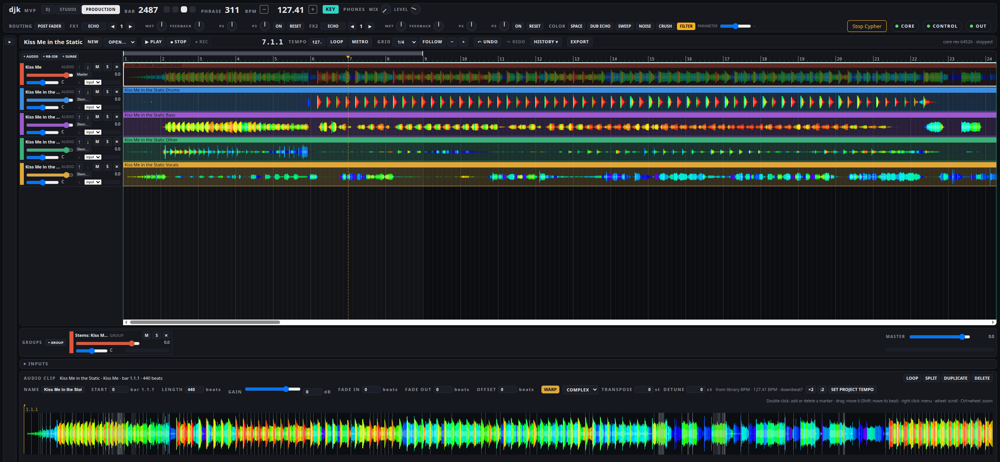
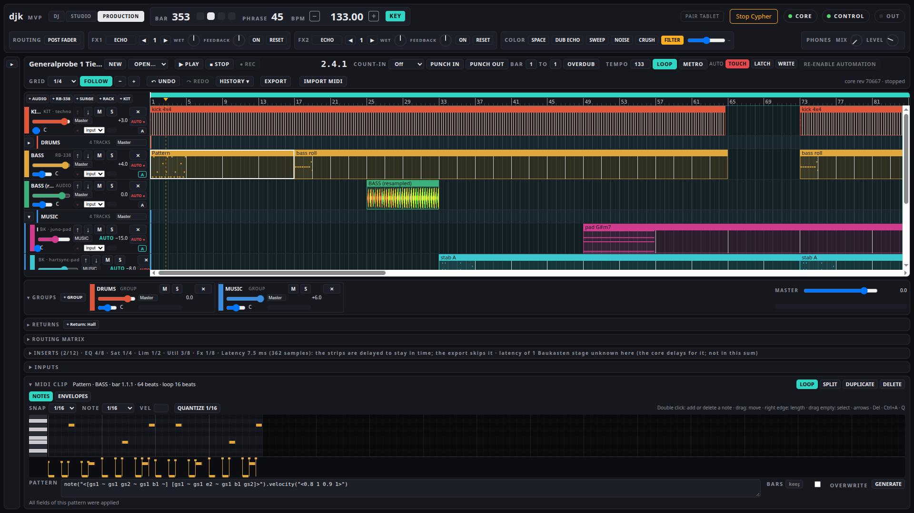

# Production, warp and stems

The PRODUCTION view sits next to DJ and STUDIO. It is an arrangement: tracks on a timeline, a library browser on the
left, a detail area for the selected clip below, a transport bar on top. The same real-time core that plays the DJ set
plays the arrangement, on the same sample clock.

## Tracks, groups, returns, master

Up to 128 tracks, 16 group tracks and 8 returns. Every track goes to the production master or into one group, and a group can go into another group: a DRUMS group can hold a KICK, a PERC and a HATS group, each with its own inserts, fader and sends. Audio tracks
take samples and tracks dragged from the library; instrument tracks play the RB-338, a Cypher Modular graph (up to 16 such
tracks) or a hosted instrument plugin (Surge XT or a third-party plugin, two such slots). To add an instrument track, double click an entry in the INSTRUMENTS list of the browser on the left (or drag it onto the arrangement): RB-338, Surge or a Cypher Modular graph. The graphs are listed under their file names, for example `synth-kraken` for Kraken and `synth-mono` for the Mono Synth. In a project without tracks the arrangement says so. Per track: volume, pan, mute, solo, a meter. Every change is one undo step, and the undo
history survives a restart.

A return takes sends from every track and group (one send per return, taken after the fader and pan) and can carry
Cypher Hall: pre-delay, decay, size, low factor, high cut, tail. A return can also take its sends before the fader of
their source (the PRE and POST switch on the return).

## Warp

An audio clip with warp on follows the project tempo, also through tempo changes.

- **Where the markers come from**: in this order, the workshop's analysis of the track (beat grid snapped to the kick),
  a Traktor grid, the bar count of a loop, the library BPM. A long track without an analysis is warped from the best
  source at once and refined when the analysis arrives, as long as the clip is not playing.
- **By hand**: the sample editor shows the clip's waveform with its markers and, in grey, the detected transients.
  Double click adds or deletes a marker, dragging moves it (with Shift its beat). Further: double or halve the tempo,
  Set 1.1.1 Here (bar one at this spot), Warp From Here (straight from here, or start here), Set Project Tempo from the
  clip.
- **Modes**:
  - RE-PITCH: varispeed, pitch follows the tempo
  - COMPLEX: time-stretched with Bungee (grain 512), pitch kept
  - TONES: the same with a shorter grain (256)
  - BEATS: the clip is cut into slices at the grid (1/4 to 1/32) or at the transients, each slice starts on its beat;
    the gap after a slice can stay silent or be filled forwards or forwards and back, with a fade
- **Transpose and detune**: -12 to +24 semitones and ±50 cents (not in RE-PITCH).
- **Quantize Audio**: moves the transients onto a 1/16 grid, as one undo step.

## Stems

Right click an audio clip, Separate Stems. BS-RoFormer (the BS-RoFormer-SW model) splits the clip's source range on the
GPU into drums, bass, other, vocals, guitar and piano. Drums, bass, other and vocals are always placed. Guitar and piano
are placed only when they are not more than 45 dB below the input; otherwise their signal is added to other, so the sum
still equals the separation. The run needs a CUDA GPU with at least 4.5 GB of free video memory (set
`CYPHERDJ_STEMS_GPU_FREI_MB` to change that threshold); if there is none, or the memory runs out, the run ends with
`keine_gpu` or `gpu_belegt` and the project stays untouched. There is no CPU path. The menu shows the progress (Cancel
Stems, 26 %) and a cancelled run leaves the project untouched. When it is done, four to six audio tracks appear under the
clip in a new group, each stem warped exactly like the original, and the original is muted. One undo step takes all of it
back. Up to 600 s of source.

On 7 November 2026, back-to-back stem jobs ran next to the real-time core with an arrangement of four Halls playing, at quantum 256 and at 128: no frame gaps and no xruns. That is why the stem run is allowed while a set plays.

How the stems sit against the original was measured on 31 October 2026 on a real track at 124 and 128 BPM, with the
previous separator (Demucs): the warp markers of the stems sit 0.000 samples from the original's, the frame count is
exact, one undo restores the project exactly. It was not repeated with BS-RoFormer.

Limits:
- No GPU, no stems. Weights: about 700 MB, downloaded from their Hugging Face repository and checked by sha256. That
  repository does not state a license for them.
- Summed after warping, the stems left a residual of about -8 dB against the warped original when measured with the
  previous separator (the warp starts each clip with its own phase). The stems are coherent with each other; together
  with the unmuted original they can comb.

## Inserts, sidechain, macros

Each track, group, return and the production master has an insert chain of up to five stages. A stage is one of our own
devices from a pool that the whole project shares: 160 compressors and 160 EQs (one of each for every track, group, return and the master), 4 saturators, 8 limiters, 8 utilities (stereo width and bass mono), 16 noise gates and 8 multiband compressors (three bands: Low, Mid, High), plus a Cypher Modular effect graph as a stage. The chain of a
return sits after its Hall, the chain of the master before the master fader (so the export carries it). A bypass is a
10 ms blend; every stage shows its gain reduction. Stages that add latency (EQ and saturator 69 samples, limiter 86
samples at 48 kHz) are compensated across tracks and groups, up to 1024 samples per place. The limiter looks ahead 1.5 ms
and detects true peaks between the samples (4x oversampled); a test tone at +6 dBFS stays under a ceiling of -1 dBFS. Because the master chain runs before the master fader, the ceiling holds with the fader at 0 dB or below.

A compressor can be keyed by another track (the Key selector on the stage). Through the agent's tools and in the project
file it can also be keyed by a group, a return, a DJ deck (1 to 4) or the drum channel; a key that would depend on the
stage itself or that is computed later than the stage is refused with a reason (`sidechain_zyklus`, `sidechain_spaet`,
`sidechain_quelle`). One command, Duck by Kick, adds a compressor stage with the values of the Kick Sidechain preset
(threshold -30 dB, ratio 8, knee 0, attack 1 ms, release 150 ms) keyed by a kick track.

A strip with a chain can have a rack of four macro knobs; a macro drives continuous parameters of the stages from a start
to an end value, up to 16 mappings per strip, and 12 racks exist per project.

Bounce and merge refuse a track that has insert stages, because their render is dry. A bounce does not bake in the chains of
groups, returns or the master either (measured: such a stage is bypassed in the bounce render).

## Automation

Lanes per track for fader, pan, mute, solo and the four smoothed RB-338 parameters (volume, cutoff, resonance, envelope
amount). A lane has points with a linear, S-shaped or jump segment into each point; up to 12 lanes per track and 8192
points per lane. Mute and solo lanes take jumps only. The A button on a track head opens the lane row. The core evaluates
lanes from the exact project beat, in live playback and in the export, so the two stay equal (the fader value is
recomputed every 16 samples, jumps and starts apply at once).

Grabbing a track's fader, pan, mute or solo by hand overrides its lane; the page shows the override until it is ended.
With a track armed for automation, the hand is recorded into its lanes in one of three modes: Touch (only the span of the
gesture is written), Latch (after the release the last value holds until stop) or Write (everything from start to stop
is overwritten). Clips carry envelopes of their own: gain on audio clips, transpose on MIDI clips, and relative track
volume and pan on any clip. Lanes for the parameters of insert stages, the rack macros and the knobs of a Cypher Modular track exist as well, drawn or recorded from the hand.

The level of a send can be automated too: the lane menu of a track offers `Send <return name>` for every send the track has
and that has no lane yet (tracks only, not groups). The lane is drawn and edited on the dB scale of the fader. It needs an
existing send: a send with a lane cannot be switched off until you delete its lane, and deleting a return removes its send
lanes. The lane is evaluated once per audio block, so a step is smoothed over up to 21 ms. In the routing matrix a send cell
with a lane carries a mark, and the tooltip reads "Automated: the lane sets this send". Nothing grabs a send lane by hand: the
send knob is stored but not heard while the lane exists.

## Takes, comping, bounce, merge

Recording keeps every pass as a take lane under the track, and what it overwrote goes to a lane named Original. Drag a
range on a take lane to comp it into the track; the edges get seam fades. A take can be auditioned on its own, live
only. Take lanes are for audio tracks; MIDI takes do not exist yet.

Merge Tracks renders two or more tracks into one new audio track. Bounce Track in Place replaces a track's clips with its
rendered audio and keeps the old ones in a lane named Before bounce; Bounce to New Track puts the render on a new track;
Paste Bounced Audio (after Copy for Bounced Paste) renders the copied material after the fader and writes it onto an audio
track at a beat, overwriting that track's main lane there. All of them are an offline render by the same core and one undo step.

## Presets

A browser for presets of our own devices (EQ, Hall, compressor, saturator, RB-338, Cypher Modular): 213 factory presets,
your own, and collections of samples, presets and devices. The Hall presets cannot be applied yet: applying one is refused, because the Hall of a return is another device. Presets are described with words from one closed vocabulary,
and the agent can search them by those words. Drag a preset onto a track, a stage or a strip row, or save the current
state of a target as a new preset.

## Slices

The slice devices of the STUDIO view are Cypher Modular instruments, so a PRODUCTION instrument track can play one like any
other Cypher Modular graph, and the same core renders it. A loop is cut in the workbench (SLICE TO TRACK on the LOOPS tab of
the shelf): by grid, or at the hits found in the audio. The track starts with one note per slice in the order of the loop.
Reorder, repeat, shorten and reverse the hits in the SLICE grid, and pitch single steps in its PITCH lane. Moving a marker
changes what a slice sounds like and leaves the notes alone; adding or removing a marker renumbers the notes of the open
module in one undo step. Selected slices can become a drum kit for a drum track (a Strudel text can play it) or a tone for
a note track. The generated track starts at 0 dB; its pan law leaves it about 3 dB below the loop.

## Arrangement, piano roll, export

**First notes:** double click in the row of an instrument track to add a MIDI clip; the selected clip opens in the
piano roll below, where a double click adds a note. PLAY starts at the start marker, and a click into the empty
arrangement moves that marker, so after a stray click PLAY may start behind the clip. EXPORT writes the master, a WAV
at 48 kHz and 32 bit float, into the `export` folder of the project (`~/cypherdj/werke/projekte/<project>/export/` on a
fresh install); the export dialog adds delivery files next to it (see below). When the export is done, SHOW FOLDER next to the
saved path opens that folder in the file manager.

**Export to.** The export dialog has a row "Export to". By default the files go to the `export` folder of the project. CHOOSE…
opens a folder picker above the dialog; pick any folder below your home folder or on a mounted disk (a folder with a hidden
name in its path is not offered) and the master, the delivery files or the per-track set are written there. Nothing is
replaced, and no copy stays in the project. PROJECT FOLDER goes back to the default. The dialog remembers the folder for all
projects; if it is gone at the next start (an unplugged disk), the row says so and that export goes to the project folder.
The rule that keeps the last three exports tidy applies to the project folder only: in your own folder nothing is ever moved.
SHOW FOLDER opens the chosen folder. On a disk without hard links (FAT, exFAT) the delivery files are copied.

**Piano roll tools:**
- **SNAP** sets the grid for drawing, moving and stretching notes: 1/32, 1/16, 1/8 and 1/4, the triplets 1/16T, 1/8T and
  1/4T, one bar (BAR), or no snapping (OFF). The grid lines follow it, also the fine ones, as long as they are at least
  6 pixels apart.
- **QUANTIZE** (or the Q key) moves the selected notes, or all notes when none is selected, onto the SNAP grid. With
  BAR or OFF it uses 1/16. **STR** is the strength in percent (100 moves a note all the way, 50 half way), **SWING** is
  the swing in percent from 50 (straight) to 75, about 67 gives a triplet feel; it works on the straight grids only.
  Swing changes the stored note positions, it is not the playback swing of the step sequencer rows. A note never
  leaves the clip or its loop. If every note is on the grid already, a message says so and nothing is written.
- **HUMANIZE** shifts the start of the selected notes (or all) by a random amount up to **TIME** percent of a sixteenth
  and their velocity by up to **±VEL** steps. Every click draws a new random shift and acts on the notes as they are now, so clicking twice shifts twice; one undo step takes a click back.
- **SCALE** keeps new notes, vertical moves and the up and down arrow keys in the key of the project (set with KEY or
  FIND): a new note lands on the nearest note of the key, an arrow key moves one step of the key. It is remembered, and
  it does nothing while the project has no key.

A pattern (Strudel) clip that was quantised or humanised counts as hand work afterwards: generating it again from the pattern then asks for `ueberschreiben`.

The agent does the same with the commands `noten_quantisieren` and `noten_humanisieren` of `proj_aendern`.

Notes are drawn in a piano roll with velocity. Tracks can share a variant group (bass A, B, C) where
one click makes one of them audible. Recording takes one of the studio's own channels, including the extra pattern
streams, onto an armed audio track, bit-identical. The WAV export is an offline render by the same core; hosted instruments are frozen first, so the file is
sample-identical to what was heard (residual -200 dBFS, measured 17 October 2026). An offline render measures LUFS, LRA
and true peak per track as it sits in the mix.

The agent has the same projects through its tools: create tracks, write clips and notes, warp, separate stems, automate,
insert and key, comp, bounce, merge, apply presets, mix, start the transport, export. Without a loop bracket the export
takes the whole song.

**Markers.** A strip above the ruler holds named markers: Intro, Drop, Break, whatever the song needs. A click on a
marker puts the start marker there (and jumps there when the transport runs). Shift click makes the stretch from that
marker to the next one the loop and switches it on; for the last marker the stretch ends with the last clip. The export
range follows the loop, so a Shift click on a marker also chooses the export range. A double click on a marker renames
it (Enter keeps the name, Escape leaves it), a drag moves it on the GRID, Delete or the right-click menu removes it.
A double click on the empty strip, or + MARKER in the transport bar (at the start marker), adds one and opens its name.
A project holds up to 64 markers, one per beat. Markers move with inserted and removed time and with the section moves
of the tracker view, and one undo takes the move back. They are labels only: they change nothing in the sound, and the
live container has none. The agent reads them with the project and writes them with `marker_setzen` and `marker_loeschen`.

**Delivery files.** EXPORT opens a dialog. The master (WAV, 48 kHz, 32 bit float) is always written and never changed;
up to four delivery files are made from it with ffmpeg and named like the master with a tag before the extension, for
example `<master>.16bit-44k.wav` or `<master>.320kbps-44k.mp3`. Formats: WAV with 16 bit, 24 bit or 32 bit float, FLAC with
16 or 24 bit, MP3 with 192, 256 or 320 kbit/s constant bit rate. Sample rates are 44.1, 48, 88.2 and 96 kHz (MP3: 44.1 or
48 kHz). The conversion uses libsoxr; a 16 bit file gets TPDF dither, which can be switched off, and there is none at 24
bit. The presets are Master only, Release (WAV 16 bit 44.1 kHz), Promo (MP3 320), Release and promo, and Custom. If one
file cannot be written (ffmpeg missing, built without libmp3lame or libsoxr), the master and the other files stay and the
page names the one that failed.

**Loudness target.** The target is either streaming (-14 LUFS and -1 dBTP) or a true peak ceiling of -1 dBTP. It is a
check, not a processor: the master and every delivery file are measured on the file itself, and the page shows the
distance in LU. A true peak above the ceiling is a warning, and a target that could not be measured is marked as not
measured. Nothing is normalised and the mix is never limited to the target.

**Metadata.** The release data of the project (title, artist, album, year, genre, ISRC) is written into the delivery
files and never into the master. The title is the project name unless you set one. WAV carries title, artist, album,
date, genre and ISRC plus a BWF `bext` chunk. FLAC adds BPM and INITIALKEY, MP3 is ID3v2.3 with TSRC, TBPM and TKEY.
Tempo and key appear only where the format has a place for them, and the key only when the project key is a major or
minor scale. The switch "Write metadata into the delivery files" turns the release tags off; ffmpeg still writes its own
encoder tag.

**One file per track.** The second mode of the dialog writes the mix, every unmuted track alone and every fed return
(wet only) as one file each into a new folder of the export folder. With a delivery format (WAV or FLAC, one format, no
MP3) the files of the set are written in that format instead of the float WAV, without tags. It renders offline, so it is
not available while a plugin stage is on. When old exports are tidied, delivery files move to the bin together with their
master and never count as exports.

The agent exports through `proj_export` (with `abgabe`, `ziel` and `ohne_meta`) and `proj_export_spuren`; the release data is
set with `abgabe_meta_setzen` in `proj_aendern`.

Limits:
- Delivery files are WAV, FLAC and MP3. No cover art, and no OGG, Opus or AAC.
- No loudness normalisation: a target only reports.
- Dither exists at 16 bit only.
- The files of a per-track set do not add up exactly to the mix: each one passes the master chain alone.

## Tracker

The TRACKER view, the fifth one in the header, shows the open production project as tracker rows: one column per
instrument track, one cell per note, the song list as the arrangement. It is not a separate document. What you write
there is in PRODUCTION at once, and the other way round.

- **Keyboard entry.** Click the grid, switch EDIT on (click EDIT or press Escape) and type notes on the two key rows
  (Z S X D C V G B H N J M and Q 2 W 3 E R 5 T 6 Y 7 U I 9 O 0 P). With EDIT off the keys only sound the instrument, and
  the message line says that EDIT is off. Digits type values, Delete clears a cell, Space plays, Ctrl+Z undoes.
- **Linked patterns.** A pattern that repeats in the song is a set of linked clips: an edit in one reaches all of them.
  PRODUCTION marks them with a chain sign. Trimming a clip unlinks it.
- **Effect commands.** Up to four effect columns take commands in the manner of the classic trackers, on a grid of
  ticks per row (6 by default): ARP arpeggio, SLU and SLD slide up and down, GLD glide to note, VIB vibrato, TRM tremolo,
  VSL volume slide, LVL set level, RTG retrigger, PAN pan, OFS sample offset and REV reverse. They are stored as
  commands and unrolled for playback, offline render and MIDI export.
- **Text form.** The agent can read and write a pattern as text through its tools.
- **IMPORT MOD.** Reads a ProTracker module into a new tracker module, samples and patterns included, as one undo step.
  What has no target (later tempo changes, position jumps, pattern loops) is counted in the report, not guessed.
- **TO DJ.** Hands the current section (up to 64 beats) to a SEQ deck, one pattern per instrument track. From there it
  is a SEQ deck like any other and runs in time with the master.
